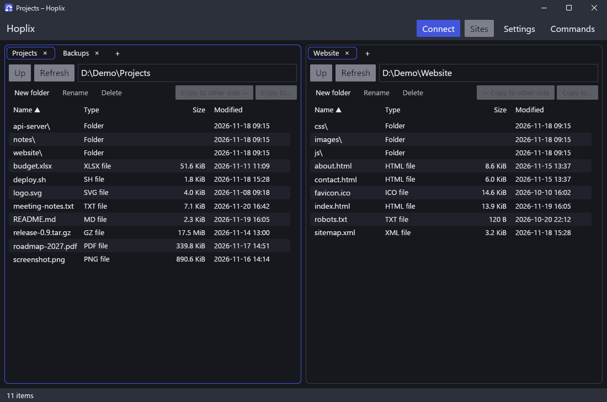

#  Hoplix

<!-- web:skip -->
[English](#english) · [Deutsch](#deutsch)
<!-- /web:skip -->

## English

Hoplix is a file transfer client for Windows and Linux, written in Rust with [iced](https://iced.rs). It connects to SFTP, FTP and FTPS servers, transfers files and whole folders, compares and synchronises folders and opens files in external programs. A command-line tool, `hoplix-cli`, uses the same core.

> **Work in progress:** Hoplix is at an early stage of development. Features, settings files and the user interface may still change.

> Feedback and bug reports are welcome as [issues](../../issues). Not affiliated with or endorsed by Microsoft, the GNOME project or KDE. Windows is a trademark of the Microsoft group of companies.

<p>
  
  
</p>

### Installation

Download one of the files from [Releases](../../releases):

- **Installer** `Hoplix-<version>-windows-x64-setup.exe` – installs Hoplix and `hoplix-cli` for the current user (default, no administrator rights, to `%LOCALAPPDATA%\Programs\Hoplix`) or for all users (to `C:\Program Files\Hoplix`, asks for administrator rights) and adds a Start menu entry and optionally a desktop shortcut. It can be removed under Settings → Apps.
- **Portable for Windows** `Hoplix-<version>-windows-x64-portable.zip` – extract it to any folder and start `hoplix.exe`. Keep the `lang` folder next to the program.
- **Portable for Linux** `Hoplix-<version>-linux-x64.tar.gz` – extract it and start `hoplix`. Keep the `lang` folder next to the program.

Versions 0.x are published as pre-releases. The programs are not signed, so SmartScreen may warn on the first start: "More info" → "Run anyway". Each file has a `.sha256` file to verify the download, and the release notes link a VirusTotal scan. Changes are listed in the [changelog](CHANGELOG.md).

#### Installer parameters

The installer accepts the usual Inno Setup parameters, e.g. for a silent installation:

| Parameter | Effect |
|---|---|
| `/CURRENTUSER` | Install for the current user only (default) |
| `/ALLUSERS` | Install for all users (asks for administrator rights) |
| `/DIR="C:\Path"` | Installation folder |
| `/SILENT`, `/VERYSILENT` | Without wizard (with or without progress window) |
| `/SUPPRESSMSGBOXES` | No message boxes in silent mode |
| `/TASKS="desktopicon"` | Add a desktop shortcut; without the parameter there is none |
| `/NOICONS` | No Start menu entry |
| `/LOG="C:\Path\setup.log"` | Write a log file |

Example: `Hoplix-0.2.0-windows-x64-setup.exe /VERYSILENT /SUPPRESSMSGBOXES /ALLUSERS /TASKS="desktopicon"`

Settings such as the language, the layout or the editor are stored per user and are not set by the installer. Uninstalling removes the program and its shortcuts but keeps your settings, sites and trusted server keys in `%APPDATA%\Hoplix` and the passwords saved in the Windows Credential Manager.

### Usage

- Every location opens in its own tab. Use **+** for a new tab and **×** to close one.
- Double-click a folder to open it, use **Up** to go to the parent folder, or type a path and press Enter.
- Click a column header to sort by it; click it again to reverse the order. The columns are name, type, size and the date of the last change in your local time.
- **Connect** opens a connection in a new tab. Protocols: SFTP (port 22), FTP (21, unencrypted), FTPS with explicit TLS (21) and FTPS with implicit TLS (990). SFTP signs in with a password or a private key file (OpenSSH format, optionally with a passphrase), FTP and FTPS with a password. **Save as site** turns the entered connection into a saved site.
- The first time you connect to an SFTP server, Hoplix shows its key fingerprint. Choose *Trust once* or *Always trust*; a changed key is refused with a warning.
- FTPS certificates are checked against the certificate authorities trusted by your system. If a certificate is not trusted (for example self-signed), Hoplix shows its SHA-256 fingerprint and asks the same way; a changed, untrusted certificate is refused.
- For plain FTP, the connect page warns that passwords and files are sent unencrypted.
- **New folder**, **Rename** and **Delete** work in local and remote tabs. Deleting asks first and removes folders with everything in them.
- Select several entries with Ctrl+click (toggle) and Shift+click (range).
- **Open and edit files:** a double-click or Enter opens a file with the default program of the system, **Edit** (F4) with the editor set in *Settings → Editor* (empty: the default program). Files from a server are first downloaded to a private temporary folder. Hoplix checks the copy every second; when it was saved, the **Edited files** list at the bottom offers *Upload* (replaces the file on the server through the transfer queue) or *Ignore*, or uploads it right away with *Settings → Upload changes automatically*. Watching ends with *Stop watching* or when the tab is closed; the copies are deleted when Hoplix closes.
- **Transfers:** drag the selection onto another tab or the other pane and release it there, use **Copy to…** to pick a target tab, or, in the classic layout, **Copy to other side**. Files and whole folders go to the folder currently open in the target, between any two places: local to server (upload), server to local (download) or server to server. Several transfers run at the same time (*Settings → Transfers → Parallel transfers*, 1 to 8, default 2); *Parallel downloads* and *Parallel uploads* cap each direction on its own (default: same as parallel transfers). *Download limit* and *Upload limit* (KiB/s or MiB/s, empty or 0 for no limit) are shared by all running transfers of that direction. A copy between two servers counts as a download and an upload: it takes a place in both directions and both speed limits apply to it. Changes apply right away; when a parallel limit is lowered, running transfers finish first.
- The **Transfers** panel at the bottom shows each transfer with progress, speed and remaining time; it can be collapsed to a one-line summary. Pause, resume, cancel, retry and remove single transfers or all at once. Paused, cancelled and failed transfers continue where they stopped. When the connection drops, Hoplix retries and resumes the file, by default three times after 1, 2 and 4 seconds (*Settings → Connections → Retries*, 0 to 10, and *First retry after*, 1 to 60 seconds; each further wait is twice as long).
- When a file already exists, Hoplix asks: overwrite, resume (if the existing file is smaller), keep both (`name (1).ext`) or skip, optionally for all further conflicts. The panel sets a fixed answer instead of asking. The target folder refreshes when a transfer is done.
- **Compare** (Ctrl+D) marks the differences between the two panes, or in the modern layout between the current tab and the one chosen under **Compare with…**: `+` only here, `»` newer here, `«` older here, `≠` same time but different size, `!` a file on one side and a folder on the other, `•` a folder whose contents differ (with *Include subfolders*). Times within 2 seconds count as equal; times from FTP listings that only show minutes or days are compared at that precision. *Only differences* hides equal entries; Ctrl+A and the arrow keys then only reach the visible ones.
- **Synchronise…** (Ctrl+Shift+D) copies between the two compared folders: left to right, right to left, or both ways (the newer file wins; files that differ only in size are skipped). *Update* copies new and newer files, *Mirror* also replaces newer files in the target and can delete files that are missing on the source. Options: include subfolders, compare the size only, skip hidden files (names starting with a dot), exclude patterns with `*` and `?` (ignoring case, separated by `;` or `,`; a pattern with `/` matches the path inside the folder). Before starting, the dialog shows how many files are uploaded, downloaded or copied, folders created and files deleted, the total size and a preview list. Deletions need the extra confirmation *Yes, delete them*. The files go through the transfer queue and keep their modification time where the server allows it.
- **Sites** keeps your servers, sorted into folders that can be nested. Create, edit, duplicate and delete sites and folders; the *Folder* field moves a site. Each site stores protocol, server, port, user name, sign-in method, key file, the remote and local folder to open, and notes. *Connect* or a double-click opens the site in a new tab named after it; a local folder opens next to it (in the other pane in the classic layout).
- **Save password** (or *Save passphrase* for key files) keeps the secret of a site. Where it is kept is chosen in **Settings → Saved passwords**: in the Windows Credential Manager or the system keyring on Linux (default), or in a file encrypted with a master password that you enter once per session. Switching moves all saved passwords; *Change master password* re-encrypts them.
- **Settings** is grouped into sections: *General* (light, dark or the system appearance, the language, and the layout: *Modern* with one browser with tabs or *Classic* with two panes side by side), *Transfers*, *Connections*, *Passwords*, *Editing* and *Updates*. The page scrolls when the window is small.
- **Updates:** Hoplix looks for a new version once a day, a few seconds after it starts, in the background (*Settings → Updates → Check for updates automatically*, on by default). *Check now* checks right away, also when the automatic check is off; the section shows the installed version, the result and when Hoplix last checked. When a newer version exists, Hoplix shows it once per version with *Open release page* (opens the GitHub release page in your browser) and *Later*; afterwards a small link *Update x.y.z available* stays at the right end of the status bar until that version is installed. Hoplix never downloads or installs anything itself. While Hoplix is a 0.x version, pre-releases are offered too; from version 1.0 on, only regular releases are offered (unless you run a pre-release yourself).
- **Commands** (Ctrl+K) opens the command palette: type a few letters of an action or of a saved site, choose with the arrow keys and press Enter; Esc closes it.
- Hoplix remembers the open tabs and the window size and position. After a restart, local tabs open again at their folder; tabs of saved sites come back *not connected* and connect with one click, so Hoplix never connects to a server on its own. Connections without a saved site are not restored.
- If the connection to a server drops, Hoplix reconnects with the same sign-in on the next action; the server key must still match. For SFTP this can be switched off with *Settings → Connections → Reconnect dropped SFTP sessions automatically*; a dropped session then stays closed until you connect again.

#### Keyboard shortcuts

Shortcuts work in the file list, not while you type in a text field.

| Keys | Action |
| --- | --- |
| Ctrl+K | Command palette |
| Enter | Open the selected folder or file |
| F4 | Edit the selected file in the external editor |
| Backspace, Alt+↑ | Parent folder |
| F5 | Refresh |
| F2 | Rename |
| Del | Delete (asks first) |
| ↑, ↓, Page ↑, Page ↓, Home, End | Move the selection; with Shift, extend it |
| Ctrl+A | Select all |
| Ctrl+D | Compare the folders, or stop comparing |
| Ctrl+Shift+D | Synchronise the folders |
| Ctrl+T, Ctrl+W | New tab, close tab |
| Ctrl+Tab, Ctrl+Shift+Tab | Next, previous tab |
| Esc | Close a dialog, the palette or a page |

#### Command line

`hoplix-cli` offers the same operations without a window:

```sh
hoplix-cli ls sftp://user@example.com/var/www --key ~/.ssh/id_ed25519
hoplix-cli get sftp://user@example.com/~/backup.tar.gz . --password-env HOPLIX_PASSWORD --resume
hoplix-cli put report.pdf sftp://user@example.com:2222/srv/files/ --key id_ed25519 --passphrase-env KEY_PASS
hoplix-cli ls ftpes://user@example.com/www --password-env HOPLIX_PASSWORD
hoplix-cli get ftp://ftp.example.com/pub/readme.txt .
hoplix-cli put -r website sftp://user@example.com/var/www --key id_ed25519 --skip-existing
hoplix-cli cp -r sftp://user@old.example.com/srv/data sftp://user@new.example.com/srv/ --key id_ed25519
hoplix-cli compare -r website sftp://user@example.com/var/www --key id_ed25519
hoplix-cli sync -r website sftp://user@example.com/var/www --key id_ed25519 --delete --exclude "*.tmp" --dry-run
```

Saved sites work as targets too, with their saved password or passphrase:

```sh
hoplix-cli sites
hoplix-cli ls "site://Web server/var/www"
hoplix-cli get site://Work%2FBackup/~/backup.tar.gz . --master-password-env HOPLIX_MASTER
```

Commands: `ls`, `stat`, `get [-r]`, `put [-r]`, `cp [-r]`, `mkdir`, `rm [-r]`, `mv`, `sites`. `-r` copies folders with everything in them; `cp` copies between any two targets, also from one server to another. If the destination is an existing folder, the source is copied into it, otherwise it gets the destination's name. Existing files are overwritten unless you pass `--resume` (complete smaller files, skip equal ones), `--skip-existing` or `--keep-both`. `--retries <n>` (0 to 10, default 3) and `--retry-delay <seconds>` (1 to 60, default 1; each further wait is twice as long) set the retries after a dropped connection. `--limit-download <rate>` and `--limit-upload <rate>` limit the speed, for example `500K` or `2M` (a number without unit means KiB/s, `0` no limit); a copy between two servers is limited by both. These four options work with `get`, `put`, `cp` and `sync`. Progress is shown on stderr when it is a terminal. `sites` lists the name and address of every site, without user names. Sites are named by name or by `folder/name` (write `/` as `%2F`); `--password-env` or `--key` override the saved secret. With a master password, pass its environment variable with `--master-password-env`. URLs start with `sftp://`, `ftp://`, `ftpes://` (FTPS, explicit TLS) or `ftps://` (FTPS, implicit TLS); FTP URLs without a user sign in anonymously. Passwords and passphrases are only read from environment variables whose name you pass, never from the command line. Unknown server keys and untrusted certificates are refused unless you add `--accept-host-key` (this run) or `--remember-host-key`. `hoplix-cli help` lists all options.

`compare <a> <b> [-r]` prints one line per difference (`only-first`, `only-second`, `newer-first`, `newer-second`, `size`, `type`) and a summary. `sync <from> <to> [-r]` copies new and newer files from `<from>` so that `<to>` matches it and creates `<to>` if it does not exist; `--mirror` also replaces files that are newer in `<to>`, `--delete` additionally deletes what is missing in `<from>`, `--dry-run` only lists the plan. Both take `--size-only`, `--skip-hidden` and `--exclude <pattern>` (several times).

### How it works

- `crates/hoplix-core` defines a common file system interface with a local, an SFTP and an FTP/FTPS backend, all in pure Rust: SFTP with `russh` and `russh-sftp`, FTP with `suppaftp`, TLS with `rustls` and `rustls-platform-verifier` (system certificate store), cryptography from `ring`.
- FTP uses passive mode (EPSV, or PASV when the server lacks it), MLSD/MLST listings when available and LIST otherwise, UTF-8 file names and REST/APPE to resume transfers. Transfers run on their own connections, so browsing stays possible meanwhile.
- The transfer queue in `hoplix-core` streams every file from the source to the target in 128 KiB blocks, so copies between two servers never touch the local disk. Folders are read first to know the total size, then copied file by file; parallel transfers run as separate jobs. SFTP runs parallel transfers as separate requests on the one SSH session, FTP opens extra connections for them. The queue starts waiting jobs in order as long as the overall limit and the limit of the job's direction allow it; a job whose direction is full is passed over, so an upload can start while downloads wait. The direction comes from the two sides: local to server is an upload, server to local a download, server to server both, local to local neither. Speed limits use one token bucket per direction that all running jobs share: every block takes its size from the bucket and waits until the bucket has been refilled at the set rate (with a burst of at most a quarter of a second); with a limit, blocks shrink to an eighth of the rate so that low limits stay smooth. Retries wait the first delay (default 1 second), twice as long with each further attempt, and continue at the size the target file already has.
- `crates/hoplix-app` contains the iced user interface, `crates/hoplix-cli` the command-line tool.
- The update check (`update` in `hoplix-core`) uses a small HTTP/1.1 client on `tokio-rustls` with the system certificate store (`rustls-platform-verifier`) and a small JSON reader for the release list, without extra crates. It picks the highest version (SemVer, including pre-release suffixes) among the releases that are not drafts, and offers it only when it is newer than the installed one.
- Comparing and synchronising (`sync.rs` in `hoplix-core`) lists both folders, matches entries by name and compares size and modification time. A sync builds a plan first (deletions, new folders, copies), so the app and `--dry-run` can show it; copies then run through the transfer queue with *overwrite*, and the modification time is set afterwards (SFTP `SETSTAT`, FTP `MFMT` or `MDTM`, locally directly). Sync uses only the connections that are already open.
- On Windows, `build/resources.rs` embeds the icon, the version information and a manifest (per-monitor DPI awareness, UTF-8) into both programs without extra tools; the version comes only from the workspace `Cargo.toml`, and a test checks that `Cargo.lock`, `CHANGELOG.md`, the installer script and the release workflow agree with it. The title bar takes the colours of the current theme.
- Texts come from `lang/<code>.lang` files (`key = text`, UTF-8) with a comment header naming the language, its category and its reviewers; [LANGUAGES.md](LANGUAGES.md) lists them. English is built in; missing texts fall back one by one to the language named with `language.fallback`, otherwise to English. `language.direction = rtl` marks a right-to-left language; it is read, but the layout is not mirrored yet.
- Sites are stored in `sites.conf` without any password. Saved passwords go to the Windows Credential Manager (entries `Hoplix:site/<id>`) or the Secret Service on Linux (GNOME Keyring, KWallet; attributes `application=Hoplix`, `name=site/<id>`). With a master password they are kept in `secrets.vault` instead: the key is derived with PBKDF2-HMAC-SHA256 (600,000 iterations, random 32-byte salt) and every entry is encrypted with AES-256-GCM (random nonce, bound to its name), all with `ring`. A forgotten master password cannot be recovered.
- Settings are stored in `%APPDATA%\Hoplix\settings.conf` on Windows and in `$XDG_CONFIG_HOME/hoplix/settings.conf` (default `~/.config/hoplix/`) on Linux. Open tabs (folder paths and site ids) and the window size and position are kept in `session.conf` next to it. Trusted server keys are kept in `known_hosts` in the same folder, in OpenSSH format, trusted FTPS certificates in `trusted_certificates` (one line per server: `host:port SHA256:…`).

### Privacy

Hoplix connects to the servers you enter yourself and, for the update check, to GitHub; there is no telemetry.

- **Update check (app only, not `hoplix-cli`):** Hoplix sends an HTTPS GET request to `api.github.com` for `/repos/TripleT3005/Hoplix/releases?per_page=10`, the list of the latest Hoplix releases. If GitHub answers with a redirect, Hoplix follows it at most three times and only to `github.com` or its subdomains. This happens once a day a few seconds after start-up while *Check for updates automatically* is on, and whenever you click *Check now*; with the automatic check off, Hoplix contacts GitHub only on *Check now*. The request carries only the headers `Host`, `User-Agent: Hoplix/<version>` (the installed version) and `Connection: close`: no cookies, no identifier, no information about your system, your settings or your servers. As with any connection, GitHub sees your IP address. Hoplix receives the release list (version, release page address, draft and pre-release flags; everything else is ignored), reads at most 1 MiB and gives up after 15 seconds. Hoplix stores the time of the last check, the newest known version with its release page and the version it last told you about in `settings.conf`. *Open release page* and the status bar link open the release page on `github.com` in your default browser; Hoplix itself downloads nothing.

- **SFTP:** Hoplix opens an SSH connection to the server and port you entered. It sends your user name and either your password or a signature made with your private key; the key itself never leaves your computer. Everything else (folder listings, files you download or upload, renames, deletions) goes through this encrypted connection only.
- **FTPS:** like FTP below, but the control connection and all data connections are encrypted with TLS. To check the certificate, the system may look up revocation information as it does for other programs.
- **FTP:** the user name, the password, folder listings and file contents are sent **unencrypted** and can be read by anyone on the way. Anonymous sign-in (`ftp://` without a user in `hoplix-cli`) sends `anonymous@` as password.
- **Saved data:** the settings file, `session.conf` with the folders of your open tabs and the window position, the `known_hosts` file with the keys of servers you chose to always trust, the `trusted_certificates` file with certificate fingerprints you chose to always trust, and `sites.conf` with your sites (no passwords). Passwords and passphrases are stored only when you tick *Save password*, and only in the Windows Credential Manager, the Linux system keyring or the encrypted `secrets.vault`, never as plain text. Nothing of this is sent anywhere.
- Locally, Hoplix reads only the folders you open. Files you open or edit from a server are copied to a folder `hoplix-edit-…` in the temporary folder of your user account and deleted when Hoplix closes; opening a file starts the default program or the editor you set, nothing else.

<!-- web:skip -->

### Building

Requires Rust 1.89 or newer.
On Debian or Ubuntu, install `pkg-config`, `libxkbcommon-dev` and `libwayland-dev` first.

```sh
cargo build --release
```

The program is `target/release/hoplix` (`hoplix.exe` on Windows); keep the `lang` folder next to it. The command-line tool is `target/release/hoplix-cli`.

Tests: `cargo test`. The SFTP integration tests are skipped by default; run them against a test server with `cargo test -p hoplix-core --test sftp -- --ignored` after setting `HOPLIX_TEST_SFTP_HOST`, `HOPLIX_TEST_SFTP_USER` and `HOPLIX_TEST_SFTP_KEY` or `HOPLIX_TEST_SFTP_PASSWORD` (optional: `HOPLIX_TEST_SFTP_PORT`, `HOPLIX_TEST_SFTP_PASSPHRASE`, `HOPLIX_TEST_SFTP_OTHER_KEY`). The keyring tests write to the real system keyring and are skipped too: `cargo test -p hoplix-core --lib -- --ignored`. The FTP tests work the same way with `--test ftp` and `HOPLIX_TEST_FTP_HOST`, `HOPLIX_TEST_FTP_USER`, `HOPLIX_TEST_FTP_PASSWORD` (optional: `HOPLIX_TEST_FTP_PORT`, `HOPLIX_TEST_FTP_PROTOCOL` = `ftp`, `ftpes` or `ftps`).

[LANGUAGES.md](LANGUAGES.md) is generated from the headers of the language files. After changing them, run `UPDATE_LANGUAGES=1 cargo test -p hoplix-core --test languages` (PowerShell: `$env:UPDATE_LANGUAGES = 1; cargo test -p hoplix-core --test languages`); the tests fail if it is out of date.

[THIRD-PARTY-LICENSES.txt](THIRD-PARTY-LICENSES.txt) is generated from `cargo tree` and `cargo metadata` and the license files of the crates. After changing dependencies, run `UPDATE_THIRD_PARTY_LICENSES=1 cargo test -p hoplix-core --test third_party_licenses` (PowerShell: `$env:UPDATE_THIRD_PARTY_LICENSES = 1; cargo test -p hoplix-core --test third_party_licenses`); the tests fail if it is out of date.

#### Releases

The version is set once in the workspace `Cargo.toml`. When a new version reaches `main`, the release workflow builds Hoplix for Windows x64 and Linux x64 and publishes it as `v<version>`: the portable ZIP, the installer (Inno Setup, `installer/hoplix.iss`, which gets the version from the workflow) and the Linux archive, each with a `.sha256` file. The section of the version in [CHANGELOG.md](CHANGELOG.md), with English and German notes, becomes the release notes; the release fails without it and while `[Unreleased]` still has entries. Versions `0.x` and versions with a suffix like `1.0.0-beta.1` are pre-releases. With the repository secret `VT_API_KEY`, all files are uploaded to VirusTotal and the scan links are added to the release notes; without it the workflow only warns. After a successful release, the repository secret `DISCORD_WEBHOOK` announces it on Discord; without it the workflow only warns. Pull requests that change the release workflow or the installer build and package everything as a dry run without publishing.

<!-- /web:skip -->

### License

[MIT](LICENSE) © TripleT3005

The licenses of the libraries used are in [THIRD-PARTY-LICENSES.txt](THIRD-PARTY-LICENSES.txt), which is included with the program.

## Deutsch

Hoplix ist ein Client zur Dateiübertragung für Windows und Linux, geschrieben in Rust mit [iced](https://iced.rs). Er verbindet sich mit SFTP-, FTP- und FTPS-Servern, überträgt Dateien und ganze Ordner, vergleicht und synchronisiert Ordner und öffnet Dateien in externen Programmen. Das Kommandozeilenwerkzeug `hoplix-cli` nutzt denselben Kern.

> **Work in progress:** Hoplix steht noch am Anfang der Entwicklung. Funktionen, Einstellungsdateien und Oberfläche können sich noch ändern.

> Rückmeldungen und Fehlerberichte gern als [Issue](../../issues). Keine Verbindung zu Microsoft, dem GNOME-Projekt oder KDE und nicht von ihnen unterstützt. Windows ist eine Marke der Microsoft-Unternehmensgruppe.

<p>
  
  
</p>

### Installation

Eine der Dateien unter [Releases](../../releases) herunterladen:

- **Installer** `Hoplix-<Version>-windows-x64-setup.exe` – installiert Hoplix und `hoplix-cli` für den aktuellen Benutzer (Standard, ohne Administratorrechte, nach `%LOCALAPPDATA%\Programs\Hoplix`) oder für alle Benutzer (nach `C:\Program Files\Hoplix`, fragt nach Administratorrechten) und legt einen Startmenü-Eintrag und auf Wunsch eine Desktop-Verknüpfung an. Entfernen lässt es sich unter Einstellungen → Apps.
- **Portabel für Windows** `Hoplix-<Version>-windows-x64-portable.zip` – in einen beliebigen Ordner entpacken und `hoplix.exe` starten. Den Ordner `lang` neben dem Programm lassen.
- **Portabel für Linux** `Hoplix-<Version>-linux-x64.tar.gz` – entpacken und `hoplix` starten. Den Ordner `lang` neben dem Programm lassen.

Versionen 0.x erscheinen als Vorabversionen. Die Programme sind nicht signiert, daher kann SmartScreen beim ersten Start warnen: „Weitere Informationen“ → „Trotzdem ausführen“. Zu jeder Datei gibt es eine `.sha256`-Datei zum Prüfen des Downloads, und die Release-Notizen verlinken einen VirusTotal-Scan. Änderungen stehen im [Changelog](CHANGELOG.md).

#### Installer-Parameter

Der Installer kennt die üblichen Inno-Setup-Parameter, z. B. für eine stille Installation:

| Parameter | Wirkung |
|---|---|
| `/CURRENTUSER` | Nur für den aktuellen Benutzer installieren (Standard) |
| `/ALLUSERS` | Für alle Benutzer installieren (fragt nach Administratorrechten) |
| `/DIR="C:\Pfad"` | Installationsordner |
| `/SILENT`, `/VERYSILENT` | Ohne Assistent (mit oder ohne Fortschrittsfenster) |
| `/SUPPRESSMSGBOXES` | Keine Meldungsfenster im stillen Modus |
| `/TASKS="desktopicon"` | Desktop-Verknüpfung anlegen; ohne den Parameter gibt es keine |
| `/NOICONS` | Kein Startmenü-Eintrag |
| `/LOG="C:\Pfad\setup.log"` | Protokolldatei schreiben |

Beispiel: `Hoplix-0.2.0-windows-x64-setup.exe /VERYSILENT /SUPPRESSMSGBOXES /ALLUSERS /TASKS="desktopicon"`

Einstellungen wie Sprache, Ansicht oder Editor gelten pro Benutzer und werden nicht über den Installer gesetzt. Die Deinstallation entfernt Programm und Verknüpfungen, lässt aber deine Einstellungen, Server und vertrauenswürdigen Serverschlüssel in `%APPDATA%\Hoplix` und die in der Windows-Anmeldeinformationsverwaltung gespeicherten Passwörter stehen.

### Bedienung

- Jeder Ort öffnet sich in einem eigenen Tab. Mit **+** öffnest du einen neuen Tab, mit **×** schließt du einen.
- Ein Doppelklick öffnet einen Ordner, **Nach oben** wechselt in den übergeordneten Ordner, oder du gibst einen Pfad ein und drückst die Eingabetaste.
- Ein Klick auf eine Spaltenüberschrift sortiert danach, ein zweiter Klick kehrt die Reihenfolge um. Die Spalten sind Name, Typ, Größe und das Datum der letzten Änderung in deiner Ortszeit.
- **Verbinden** öffnet eine Verbindung in einem neuen Tab. Protokolle: SFTP (Port 22), FTP (21, unverschlüsselt), FTPS mit explizitem TLS (21) und FTPS mit implizitem TLS (990). Bei SFTP meldest du dich mit Passwort oder privater Schlüsseldatei an (OpenSSH-Format, optional mit Passphrase), bei FTP und FTPS mit Passwort. **Als Server speichern** macht aus der eingegebenen Verbindung einen gespeicherten Server.
- Beim ersten Verbinden mit einem SFTP-Server zeigt Hoplix den Fingerabdruck seines Schlüssels. Wähle *Einmal vertrauen* oder *Immer vertrauen*; ein geänderter Schlüssel wird mit einer Warnung abgelehnt.
- FTPS-Zertifikate werden gegen die Zertifizierungsstellen geprüft, denen dein System vertraut. Ist ein Zertifikat nicht vertrauenswürdig (zum Beispiel selbst signiert), zeigt Hoplix seinen SHA-256-Fingerabdruck und fragt genauso nach; ein geändertes, nicht vertrauenswürdiges Zertifikat wird abgelehnt.
- Bei reinem FTP warnt die Verbindungsseite, dass Passwort und Dateien unverschlüsselt übertragen werden.
- **Neuer Ordner**, **Umbenennen** und **Löschen** funktionieren in lokalen und entfernten Tabs. Löschen fragt vorher nach und entfernt Ordner samt Inhalt.
- Mehrere Einträge wählst du mit Strg+Klick (einzeln dazu oder weg) und Umschalt+Klick (Bereich) aus.
- **Dateien öffnen und bearbeiten:** Ein Doppelklick oder die Eingabetaste öffnet eine Datei mit dem Standardprogramm des Systems, **Bearbeiten** (F4) mit dem Editor aus *Einstellungen → Editor* (leer: Standardprogramm). Dateien vom Server werden dazu erst in einen privaten temporären Ordner heruntergeladen. Hoplix prüft die Kopie jede Sekunde; wurde sie gespeichert, bietet die Liste **Bearbeitete Dateien** unten *Hochladen* (ersetzt die Datei auf dem Server über die Übertragungswarteschlange) oder *Ignorieren* an, mit *Einstellungen → Änderungen automatisch hochladen* lädt Hoplix sie sofort hoch. Das Beobachten endet mit *Nicht mehr beobachten* oder wenn der Tab geschlossen wird; die Kopien werden beim Beenden gelöscht.
- **Übertragungen:** Zieh die Auswahl auf einen anderen Tab oder den anderen Bereich und lass sie dort los, wähle über **Kopieren nach …** einen Ziel-Tab oder nutze in der klassischen Ansicht **Zur anderen Seite kopieren**. Dateien und ganze Ordner landen im Ordner, der im Ziel gerade offen ist, zwischen beliebigen Orten: lokal zum Server (Hochladen), vom Server nach lokal (Herunterladen) oder von Server zu Server. Mehrere Übertragungen laufen gleichzeitig (*Einstellungen → Übertragungen → Gleichzeitige Übertragungen*, 1 bis 8, Standard 2); *Gleichzeitige Downloads* und *Gleichzeitige Uploads* begrenzen jede Richtung für sich (Standard: wie gleichzeitige Übertragungen). *Download-Limit* und *Upload-Limit* (KiB/s oder MiB/s, leer oder 0 für unbegrenzt) gelten gemeinsam für alle laufenden Übertragungen dieser Richtung. Eine Kopie zwischen zwei Servern zählt als Download und als Upload: Sie belegt in beiden Richtungen einen Platz, und für sie gelten beide Tempolimits. Änderungen wirken sofort; wird eine Grenze für gleichzeitige Übertragungen gesenkt, laufen bereits laufende Übertragungen erst zu Ende.
- Der Bereich **Übertragungen** unten zeigt jede Übertragung mit Fortschritt, Geschwindigkeit und Restzeit; eingeklappt bleibt eine Zeile mit Zusammenfassung. Einzelne oder alle Übertragungen lassen sich pausieren, fortsetzen, abbrechen, wiederholen und entfernen. Pausierte, abgebrochene und fehlgeschlagene Übertragungen machen dort weiter, wo sie aufgehört haben. Reißt die Verbindung ab, versucht Hoplix es erneut und setzt die Datei fort, standardmäßig dreimal nach 1, 2 und 4 Sekunden (*Einstellungen → Verbindungen → Wiederholungen*, 0 bis 10, und *Erste Wiederholung nach*, 1 bis 60 Sekunden; jede weitere Wartezeit ist doppelt so lang).
- Existiert eine Datei schon, fragt Hoplix nach: überschreiben, fortsetzen (wenn die vorhandene Datei kleiner ist), beide behalten (`Name (1).ext`) oder überspringen, auf Wunsch für alle weiteren Konflikte. Im Bereich lässt sich stattdessen eine feste Antwort einstellen. Nach einer Übertragung wird der Zielordner neu geladen.
- **Vergleichen** (Strg+D) markiert die Unterschiede zwischen den beiden Bereichen, in der modernen Ansicht zwischen dem aktuellen Tab und dem unter **Vergleichen mit…** gewählten: `+` nur hier, `»` hier neuer, `«` hier älter, `≠` gleiche Zeit, aber andere Größe, `!` auf einer Seite Datei, auf der anderen Ordner, `•` Ordner mit unterschiedlichem Inhalt (mit *Unterordner einbeziehen*). Zeiten bis 2 Sekunden Abstand gelten als gleich; Zeiten aus FTP-Listen, die nur Minuten oder Tage zeigen, werden in dieser Genauigkeit verglichen. *Nur Unterschiede* blendet gleiche Einträge aus; Strg+A und die Pfeiltasten erreichen dann nur die sichtbaren.
- **Synchronisieren…** (Strg+Umschalt+D) kopiert zwischen den beiden verglichenen Ordnern: von links nach rechts, von rechts nach links oder in beide Richtungen (die neuere Datei gewinnt; Dateien, die sich nur in der Größe unterscheiden, werden übersprungen). *Aktualisieren* kopiert neue und neuere Dateien, *Spiegeln* ersetzt auch neuere Dateien im Ziel und kann Dateien löschen, die in der Quelle fehlen. Optionen: Unterordner einbeziehen, nur die Größe vergleichen, versteckte Dateien überspringen (Namen mit Punkt am Anfang), Ausschlussmuster mit `*` und `?` (ohne Groß-/Kleinschreibung, getrennt durch `;` oder `,`; ein Muster mit `/` gilt für den Pfad im Ordner). Vor dem Start zeigt der Dialog, wie viele Dateien hoch- oder heruntergeladen bzw. kopiert, Ordner angelegt und Dateien gelöscht werden, die Gesamtgröße und eine Vorschauliste. Löschen braucht die zusätzliche Bestätigung *Ja, löschen*. Die Dateien laufen über die Übertragungswarteschlange und behalten ihre Änderungszeit, soweit der Server das erlaubt.
- **Server** verwaltet deine Server, sortiert in Ordner, die sich verschachteln lassen. Server und Ordner lassen sich anlegen, bearbeiten, duplizieren und löschen; über das Feld *Ordner* verschiebst du einen Server. Gespeichert werden Protokoll, Server, Port, Benutzername, Anmeldeart, Schlüsseldatei, der zu öffnende Ordner auf dem Server und lokal sowie Notizen. *Verbinden* oder ein Doppelklick öffnet den Server in einem neuen Tab mit seinem Namen; ein lokaler Ordner öffnet sich daneben (in der klassischen Ansicht im anderen Bereich).
- **Passwort speichern** (bzw. *Passphrase speichern* bei Schlüsseldateien) merkt sich das Geheimnis eines Servers. Wo, legst du unter **Einstellungen → Gespeicherte Passwörter** fest: in der Windows-Anmeldeinformationsverwaltung bzw. im Schlüsselbund des Systems unter Linux (Standard) oder in einer mit einem Master-Passwort verschlüsselten Datei, die du einmal pro Sitzung entsperrst. Beim Wechsel ziehen alle gespeicherten Passwörter mit um; *Master-Passwort ändern* verschlüsselt sie neu.
- Die **Einstellungen** sind in Abschnitte gegliedert: *Allgemein* (hell, dunkel oder wie im System, die Sprache und die Ansicht: *Modern* mit einem Browser mit Tabs oder *Klassisch* mit zwei Bereichen nebeneinander), *Übertragungen*, *Verbindungen*, *Passwörter*, *Bearbeiten* und *Updates*. Bei einem kleinen Fenster lässt sich die Seite scrollen.
- **Updates:** Hoplix sucht einmal am Tag, ein paar Sekunden nach dem Start, im Hintergrund nach einer neuen Version (*Einstellungen → Updates → Automatisch nach Updates suchen*, standardmäßig an). *Jetzt prüfen* prüft sofort, auch wenn die automatische Prüfung aus ist; der Abschnitt zeigt die installierte Version, das Ergebnis und wann Hoplix zuletzt geprüft hat. Gibt es eine neuere Version, zeigt Hoplix sie einmal pro Version mit *Release-Seite öffnen* (öffnet die Release-Seite auf GitHub im Browser) und *Später* an; danach bleibt ein kleiner Link *Update x.y.z verfügbar* rechts in der Statusleiste, bis diese Version installiert ist. Hoplix lädt selbst nie etwas herunter und installiert nichts. Solange Hoplix eine 0.x-Version ist, werden auch Vorabversionen angeboten; ab Version 1.0 nur reguläre Versionen (außer du nutzt selbst eine Vorabversion).
- **Befehle** (Strg+K) öffnet die Befehlspalette: Tippe ein paar Buchstaben einer Aktion oder eines gespeicherten Servers, wähle mit den Pfeiltasten und drücke die Eingabetaste; Esc schließt sie.
- Hoplix merkt sich die offenen Tabs sowie Größe und Position des Fensters. Nach einem Neustart öffnen sich lokale Tabs wieder in ihrem Ordner; Tabs gespeicherter Server kommen *nicht verbunden* zurück und verbinden sich mit einem Klick, Hoplix verbindet sich also nie von selbst. Verbindungen ohne gespeicherten Server werden nicht wiederhergestellt.
- Bricht die Verbindung zu einem Server ab, verbindet sich Hoplix bei der nächsten Aktion mit derselben Anmeldung neu; der Serverschlüssel muss weiterhin passen. Für SFTP lässt sich das unter *Einstellungen → Verbindungen → Abgebrochene SFTP-Sitzungen automatisch neu verbinden* abschalten; eine abgebrochene Sitzung bleibt dann geschlossen, bis du dich neu verbindest.

#### Tastenkürzel

Die Kürzel wirken in der Dateiliste, nicht während du in ein Textfeld tippst.

| Tasten | Aktion |
| --- | --- |
| Strg+K | Befehlspalette |
| Eingabe | Ausgewählten Ordner oder ausgewählte Datei öffnen |
| F4 | Ausgewählte Datei im externen Editor bearbeiten |
| Rücktaste, Alt+↑ | Übergeordneter Ordner |
| F5 | Aktualisieren |
| F2 | Umbenennen |
| Entf | Löschen (mit Rückfrage) |
| ↑, ↓, Bild ↑, Bild ↓, Pos1, Ende | Auswahl bewegen; mit Umschalt erweitern |
| Strg+A | Alles auswählen |
| Strg+D | Ordner vergleichen bzw. Vergleich beenden |
| Strg+Umschalt+D | Ordner synchronisieren |
| Strg+T, Strg+W | Neuer Tab, Tab schließen |
| Strg+Tab, Strg+Umschalt+Tab | Nächster, vorheriger Tab |
| Esc | Dialog, Palette oder Seite schließen |

#### Kommandozeile

`hoplix-cli` bietet dieselben Vorgänge ohne Fenster:

```sh
hoplix-cli ls sftp://user@example.com/var/www --key ~/.ssh/id_ed25519
hoplix-cli get sftp://user@example.com/~/backup.tar.gz . --password-env HOPLIX_PASSWORD --resume
hoplix-cli put report.pdf sftp://user@example.com:2222/srv/files/ --key id_ed25519 --passphrase-env KEY_PASS
hoplix-cli ls ftpes://user@example.com/www --password-env HOPLIX_PASSWORD
hoplix-cli get ftp://ftp.example.com/pub/readme.txt .
hoplix-cli put -r website sftp://user@example.com/var/www --key id_ed25519 --skip-existing
hoplix-cli cp -r sftp://user@old.example.com/srv/data sftp://user@new.example.com/srv/ --key id_ed25519
hoplix-cli compare -r website sftp://user@example.com/var/www --key id_ed25519
hoplix-cli sync -r website sftp://user@example.com/var/www --key id_ed25519 --delete --exclude "*.tmp" --dry-run
```

Gespeicherte Server lassen sich ebenfalls als Ziel angeben, mit ihrem gespeicherten Passwort bzw. ihrer Passphrase:

```sh
hoplix-cli sites
hoplix-cli ls "site://Web server/var/www"
hoplix-cli get site://Work%2FBackup/~/backup.tar.gz . --master-password-env HOPLIX_MASTER
```

Befehle: `ls`, `stat`, `get [-r]`, `put [-r]`, `cp [-r]`, `mkdir`, `rm [-r]`, `mv`, `sites`. `-r` kopiert Ordner samt Inhalt; `cp` kopiert zwischen zwei beliebigen Zielen, auch von einem Server zum anderen. Ist das Ziel ein vorhandener Ordner, landet die Quelle darin, sonst bekommt sie den Namen des Ziels. Vorhandene Dateien werden überschrieben, außer du gibst `--resume` (kleinere Dateien fertig übertragen, gleich große überspringen), `--skip-existing` oder `--keep-both` an. `--retries <n>` (0 bis 10, Standard 3) und `--retry-delay <Sekunden>` (1 bis 60, Standard 1; jede weitere Wartezeit ist doppelt so lang) legen die Wiederholungen nach einem Verbindungsabbruch fest. `--limit-download <Rate>` und `--limit-upload <Rate>` begrenzen das Tempo, zum Beispiel `500K` oder `2M` (eine Zahl ohne Einheit bedeutet KiB/s, `0` unbegrenzt); eine Kopie zwischen zwei Servern begrenzen beide. Diese vier Optionen gelten für `get`, `put`, `cp` und `sync`. Den Fortschritt zeigt das Werkzeug auf stderr, wenn das ein Terminal ist. `sites` listet Namen und Adresse jedes Servers auf, ohne Benutzernamen. Server werden über ihren Namen oder `Ordner/Name` angesprochen (`/` als `%2F` schreiben); `--password-env` oder `--key` ersetzen das gespeicherte Geheimnis. Mit Master-Passwort gibst du dessen Umgebungsvariable mit `--master-password-env` an. URLs beginnen mit `sftp://`, `ftp://`, `ftpes://` (FTPS, explizites TLS) oder `ftps://` (FTPS, implizites TLS); FTP-URLs ohne Benutzer melden sich anonym an. Passwörter und Passphrasen liest das Werkzeug nur aus Umgebungsvariablen, deren Namen du angibst, nie von der Befehlszeile. Unbekannte Serverschlüssel und nicht vertrauenswürdige Zertifikate werden abgelehnt, außer du gibst `--accept-host-key` (nur dieser Aufruf) oder `--remember-host-key` an. `hoplix-cli help` zeigt alle Optionen.

`compare <a> <b> [-r]` gibt pro Unterschied eine Zeile aus (`only-first`, `only-second`, `newer-first`, `newer-second`, `size`, `type`) und eine Zusammenfassung. `sync <von> <nach> [-r]` kopiert neue und neuere Dateien aus `<von>`, sodass `<nach>` dazu passt, und legt `<nach>` an, wenn es fehlt; `--mirror` ersetzt auch Dateien, die in `<nach>` neuer sind, `--delete` löscht zusätzlich, was in `<von>` fehlt, `--dry-run` zeigt nur den Plan. Beide kennen `--size-only`, `--skip-hidden` und `--exclude <Muster>` (mehrfach).

### Funktionsweise

- `crates/hoplix-core` legt eine gemeinsame Schnittstelle für Dateisysteme fest und enthält das lokale Dateisystem, SFTP und FTP/FTPS, alles in reinem Rust: SFTP mit `russh` und `russh-sftp`, FTP mit `suppaftp`, TLS mit `rustls` und `rustls-platform-verifier` (Zertifikatsspeicher des Systems), Kryptografie aus `ring`.
- FTP nutzt den passiven Modus (EPSV, oder PASV, wenn der Server EPSV nicht kennt), MLSD/MLST-Listen, wenn vorhanden, sonst LIST, UTF-8-Dateinamen und REST/APPE zum Fortsetzen. Übertragungen laufen über eigene Verbindungen, sodass du währenddessen weiter durchsuchen kannst.
- Die Übertragungswarteschlange in `hoplix-core` reicht jede Datei in Blöcken von 128 KiB von der Quelle zum Ziel durch, Kopien zwischen zwei Servern berühren daher nie die lokale Festplatte. Ordner werden zuerst gelesen, um die Gesamtgröße zu kennen, und dann Datei für Datei kopiert; gleichzeitige Übertragungen laufen als eigene Aufträge. SFTP schickt gleichzeitige Übertragungen als getrennte Anfragen über die eine SSH-Sitzung, FTP öffnet dafür zusätzliche Verbindungen. Die Warteschlange startet wartende Aufträge der Reihe nach, solange die Gesamtgrenze und die Grenze der Richtung des Auftrags es zulassen; ein Auftrag, dessen Richtung voll ist, wird übersprungen, sodass zum Beispiel ein Upload starten kann, während Downloads warten. Die Richtung ergibt sich aus den beiden Seiten: lokal zum Server ist ein Upload, vom Server nach lokal ein Download, von Server zu Server beides, lokal zu lokal keins. Tempolimits nutzen pro Richtung einen Token-Bucket, den sich alle laufenden Aufträge teilen: Jeder Block nimmt seine Größe aus dem Bucket und wartet, bis der Bucket mit der eingestellten Rate wieder aufgefüllt ist (mit einem Vorrat von höchstens einer Viertelsekunde); mit Limit schrumpfen die Blöcke auf ein Achtel der Rate, damit auch niedrige Limits gleichmäßig bleiben. Wiederholungen warten die erste Wartezeit (Standard 1 Sekunde), mit jedem weiteren Versuch doppelt so lang, und machen bei der Größe weiter, die die Zieldatei schon hat.
- `crates/hoplix-app` enthält die Oberfläche mit iced, `crates/hoplix-cli` das Kommandozeilenwerkzeug.
- Die Update-Prüfung (`update` in `hoplix-core`) nutzt einen kleinen HTTP/1.1-Client auf `tokio-rustls` mit dem Zertifikatsspeicher des Systems (`rustls-platform-verifier`) und einen kleinen JSON-Leser für die Versionsliste, ohne zusätzliche Crates. Sie wählt unter den Versionen, die keine Entwürfe sind, die höchste (SemVer, einschließlich Vorabversions-Zusätzen) und bietet sie nur an, wenn sie neuer als die installierte ist.
- Vergleichen und Synchronisieren (`sync.rs` in `hoplix-core`) liest beide Ordner, ordnet die Einträge über den Namen zu und vergleicht Größe und Änderungszeit. Eine Synchronisierung erstellt zuerst einen Plan (Löschen, neue Ordner, Kopien), den die App und `--dry-run` anzeigen; die Kopien laufen dann mit *Überschreiben* über die Übertragungswarteschlange, danach wird die Änderungszeit gesetzt (SFTP `SETSTAT`, FTP `MFMT` oder `MDTM`, lokal direkt). Die Synchronisierung nutzt nur die bereits offenen Verbindungen.
- Unter Windows bettet `build/resources.rs` Icon, Versionsinfo und ein Manifest (DPI pro Monitor, UTF-8) ohne zusätzliche Werkzeuge in beide Programme ein; die Version steht nur in der `Cargo.toml` des Workspaces, ein Test prüft, dass `Cargo.lock`, `CHANGELOG.md`, das Installer-Skript und der Release-Workflow dazu passen. Die Titelleiste übernimmt die Farben des aktuellen Designs.
- Die Texte stammen aus `lang/<code>.lang` (`Schlüssel = Text`, UTF-8) mit einem Kommentarkopf, der Sprache, Kategorie und Prüfende nennt; [LANGUAGES.md](LANGUAGES.md) listet sie auf. Englisch ist eingebaut; fehlende Texte fallen einzeln auf die mit `language.fallback` genannte Sprache zurück, sonst auf Englisch. `language.direction = rtl` kennzeichnet eine Sprache mit Schreibrichtung von rechts nach links; das wird gelesen, die Oberfläche aber noch nicht gespiegelt.
- Server stehen ohne Passwörter in `sites.conf`. Gespeicherte Passwörter landen in der Windows-Anmeldeinformationsverwaltung (Einträge `Hoplix:site/<id>`) bzw. unter Linux im Secret Service (GNOME Keyring, KWallet; Attribute `application=Hoplix`, `name=site/<id>`). Mit Master-Passwort liegen sie stattdessen in `secrets.vault`: Der Schlüssel wird mit PBKDF2-HMAC-SHA256 abgeleitet (600.000 Durchläufe, zufälliges 32-Byte-Salt), jeder Eintrag ist mit AES-256-GCM verschlüsselt (zufällige Nonce, an seinen Namen gebunden), alles mit `ring`. Ein vergessenes Master-Passwort lässt sich nicht wiederherstellen.
- Die Einstellungen liegen unter Windows in `%APPDATA%\Hoplix\settings.conf`, unter Linux in `$XDG_CONFIG_HOME/hoplix/settings.conf` (standardmäßig `~/.config/hoplix/`). Offene Tabs (Ordnerpfade und Server-IDs) sowie Größe und Position des Fensters stehen daneben in `session.conf`. Vertrauenswürdige Serverschlüssel stehen im selben Ordner in `known_hosts` im OpenSSH-Format, vertrauenswürdige FTPS-Zertifikate in `trusted_certificates` (eine Zeile pro Server: `host:port SHA256:…`).

### Datenschutz

Hoplix verbindet sich mit den Servern, die du selbst eingibst, und für die Update-Prüfung mit GitHub; es gibt keine Telemetrie.

- **Update-Prüfung (nur die App, nicht `hoplix-cli`):** Hoplix sendet eine HTTPS-GET-Anfrage an `api.github.com` für `/repos/TripleT3005/Hoplix/releases?per_page=10`, die Liste der neuesten Hoplix-Versionen. Antwortet GitHub mit einer Weiterleitung, folgt Hoplix ihr höchstens dreimal und nur zu `github.com` oder dessen Subdomains. Das geschieht einmal am Tag ein paar Sekunden nach dem Start, solange *Automatisch nach Updates suchen* an ist, und immer, wenn du auf *Jetzt prüfen* klickst; mit ausgeschalteter automatischer Prüfung kontaktiert Hoplix GitHub nur bei *Jetzt prüfen*. Die Anfrage enthält nur die Header `Host`, `User-Agent: Hoplix/<Version>` (die installierte Version) und `Connection: close`: keine Cookies, keine Kennung, keine Angaben zu deinem System, deinen Einstellungen oder deinen Servern. Wie bei jeder Verbindung sieht GitHub deine IP-Adresse. Hoplix empfängt die Versionsliste (Version, Adresse der Release-Seite, Kennzeichen für Entwurf und Vorabversion; alles andere wird ignoriert), liest höchstens 1 MiB und bricht nach 15 Sekunden ab. In `settings.conf` speichert Hoplix den Zeitpunkt der letzten Prüfung, die neueste bekannte Version mit ihrer Release-Seite und die Version, auf die es zuletzt hingewiesen hat. *Release-Seite öffnen* und der Link in der Statusleiste öffnen die Release-Seite auf `github.com` in deinem Standardbrowser; Hoplix selbst lädt nichts herunter.

- **SFTP:** Hoplix baut eine SSH-Verbindung zum eingegebenen Server und Port auf. Gesendet werden dein Benutzername und entweder dein Passwort oder eine mit deinem privaten Schlüssel erzeugte Signatur; der Schlüssel selbst verlässt deinen Rechner nie. Alles Weitere (Ordnerlisten, herunter- oder hochgeladene Dateien, Umbenennen, Löschen) läuft nur über diese verschlüsselte Verbindung.
- **FTPS:** wie FTP unten, aber die Steuerverbindung und alle Datenverbindungen sind mit TLS verschlüsselt. Zur Prüfung des Zertifikats kann das System Sperrinformationen abrufen, wie bei anderen Programmen auch.
- **FTP:** Benutzername, Passwort, Ordnerlisten und Dateiinhalte werden **unverschlüsselt** übertragen und können unterwegs mitgelesen werden. Bei anonymer Anmeldung (`ftp://` ohne Benutzer in `hoplix-cli`) wird `anonymous@` als Passwort gesendet.
- **Gespeichert** werden die Einstellungsdatei, `session.conf` mit den Ordnern deiner offenen Tabs und der Fensterposition, die Datei `known_hosts` mit den Schlüsseln der Server, denen du immer vertraust, die Datei `trusted_certificates` mit den Zertifikats-Fingerabdrücken, denen du immer vertraust, und `sites.conf` mit deinen Servern (ohne Passwörter). Passwörter und Passphrasen werden nur gespeichert, wenn du *Passwort speichern* ankreuzt, und nur in der Windows-Anmeldeinformationsverwaltung, im Schlüsselbund des Systems unter Linux oder in der verschlüsselten `secrets.vault`, nie im Klartext. Nichts davon wird irgendwohin gesendet.
- Lokal liest Hoplix nur die Ordner, die du öffnest. Dateien vom Server, die du öffnest oder bearbeitest, werden in einen Ordner `hoplix-edit-…` im temporären Ordner deines Benutzerkontos kopiert und beim Beenden gelöscht; beim Öffnen startet Hoplix nur das Standardprogramm oder den eingestellten Editor.

<!-- web:skip -->

### Bauen

Benötigt Rust 1.89 oder neuer.
Unter Debian oder Ubuntu vorher `pkg-config`, `libxkbcommon-dev` und `libwayland-dev` installieren.

```sh
cargo build --release
```

Das Programm liegt unter `target/release/hoplix` (unter Windows `hoplix.exe`); der Ordner `lang` gehört daneben. Das Kommandozeilenwerkzeug ist `target/release/hoplix-cli`.

Tests: `cargo test`. Die SFTP-Integrationstests sind standardmäßig übersprungen; gegen einen Testserver laufen sie mit `cargo test -p hoplix-core --test sftp -- --ignored`, nachdem `HOPLIX_TEST_SFTP_HOST`, `HOPLIX_TEST_SFTP_USER` und `HOPLIX_TEST_SFTP_KEY` oder `HOPLIX_TEST_SFTP_PASSWORD` gesetzt sind (optional: `HOPLIX_TEST_SFTP_PORT`, `HOPLIX_TEST_SFTP_PASSPHRASE`, `HOPLIX_TEST_SFTP_OTHER_KEY`). Die Schlüsselbund-Tests schreiben in den echten Schlüsselbund des Systems und sind ebenfalls übersprungen: `cargo test -p hoplix-core --lib -- --ignored`. Die FTP-Tests funktionieren genauso mit `--test ftp` und `HOPLIX_TEST_FTP_HOST`, `HOPLIX_TEST_FTP_USER`, `HOPLIX_TEST_FTP_PASSWORD` (optional: `HOPLIX_TEST_FTP_PORT`, `HOPLIX_TEST_FTP_PROTOCOL` = `ftp`, `ftpes` oder `ftps`).

[LANGUAGES.md](LANGUAGES.md) wird aus den Köpfen der Sprachdateien erzeugt. Nach Änderungen daran `UPDATE_LANGUAGES=1 cargo test -p hoplix-core --test languages` (PowerShell: `$env:UPDATE_LANGUAGES = 1; cargo test -p hoplix-core --test languages`) ausführen; die Tests schlagen fehl, wenn sie veraltet ist.

[THIRD-PARTY-LICENSES.txt](THIRD-PARTY-LICENSES.txt) wird mit `cargo tree` und `cargo metadata` aus den Lizenzdateien der Crates erzeugt. Nach Änderungen an den Abhängigkeiten `UPDATE_THIRD_PARTY_LICENSES=1 cargo test -p hoplix-core --test third_party_licenses` (PowerShell: `$env:UPDATE_THIRD_PARTY_LICENSES = 1; cargo test -p hoplix-core --test third_party_licenses`) ausführen; die Tests schlagen fehl, wenn sie veraltet ist.

#### Releases

Die Version steht nur in der `Cargo.toml` des Workspaces. Sobald eine neue Version auf `main` landet, baut der Release-Workflow Hoplix für Windows x64 und Linux x64 und veröffentlicht es als `v<Version>`: die portable ZIP, den Installer (Inno Setup, `installer/hoplix.iss`, der die Version vom Workflow bekommt) und das Linux-Archiv, jeweils mit einer `.sha256`-Datei. Der Abschnitt der Version in der [CHANGELOG.md](CHANGELOG.md) mit englischen und deutschen Notizen wird zu den Release-Notizen; ohne ihn und solange `[Unreleased]` noch Einträge hat, schlägt das Release fehl. Versionen `0.x` und Versionen mit Zusatz wie `1.0.0-beta.1` sind Vorabversionen. Mit dem Repository-Secret `VT_API_KEY` werden alle Dateien zu VirusTotal hochgeladen und die Scan-Links in die Release-Notizen eingetragen; ohne das Secret warnt der Workflow nur. Nach einem erfolgreichen Release wird es über das Repository-Secret `DISCORD_WEBHOOK` auf Discord angekündigt; ohne das Secret gibt es nur eine Warnung. Pull Requests, die den Release-Workflow oder den Installer ändern, bauen und packen alles nur zur Probe, ohne zu veröffentlichen.

<!-- /web:skip -->

### Lizenz

[MIT](LICENSE) © TripleT3005

Die Lizenzen der verwendeten Bibliotheken stehen in [THIRD-PARTY-LICENSES.txt](THIRD-PARTY-LICENSES.txt), die dem Programm beiliegt.
