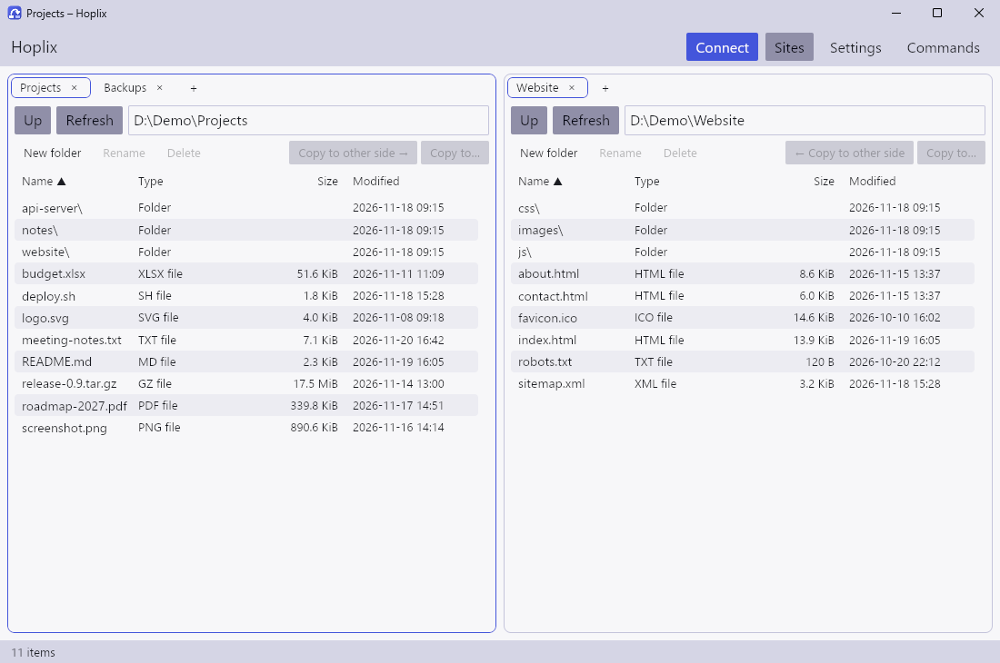

#  Hoplix

<!-- web:skip -->
[English](#english) · [Deutsch](#deutsch)
<!-- /web:skip -->

## English

Hoplix is a file transfer client for Windows and Linux, written in Rust with [iced](https://iced.rs). It connects to SFTP, FTP and FTPS servers, transfers files and whole folders, compares and synchronises folders and opens files in external programs. A command-line tool, `hoplix-cli`, uses the same core.

> **Work in progress:** Hoplix is at an early stage of development. Features, settings files and the user interface may still change.

> Feedback and bug reports are welcome as [issues](../../issues). Not affiliated with or endorsed by Microsoft, the GNOME project or KDE. Windows is a trademark of the Microsoft group of companies.

<p>
  
  
</p>

### Features
- SFTP, FTP and FTPS (explicit and implicit TLS), with SSH agent, jump host and SOCKS5 or HTTP proxy
- Site manager with folders, export and import; passwords in the system keyring or a file encrypted with a master password
- Transfer queue with resume, parallel and speed limits, a history and optional checksum checks
- Compare and synchronise folders, locally and on servers
- Edit files from servers in an external editor and upload the saved changes
- Preview of text files next to the file list
- Modern layout with tabs or classic layout with two panes
- Light and dark mode, English and German
- `hoplix-cli` for scripts, with the same core and the saved sites
- No telemetry; the only network access apart from your servers is an optional update check (see [Privacy](#privacy))

### Installation

Download one of the files from [Releases](../../releases):

- **Installer** `Hoplix-<version>-windows-x64-setup.exe` – installs Hoplix and `hoplix-cli` for the current user (default, no administrator rights, to `%LOCALAPPDATA%\Programs\Hoplix`) or for all users (to `C:\Program Files\Hoplix`, asks for administrator rights) and adds a Start menu entry and optionally a desktop shortcut. It can be removed under Settings → Apps.
- **Portable for Windows** `Hoplix-<version>-windows-x64-portable.zip` – extract it to any folder, for example on a USB stick, and start `hoplix.exe`. Keep the `lang` folder next to the program. The ZIP contains the file `hoplix.portable`: while it is next to the program, Hoplix keeps everything in the `config` folder beside it (see *Portable mode* below).
- **Debian, Ubuntu and derivatives** `hoplix_<version>_amd64.deb` – install it with `sudo apt install ./hoplix_<version>_amd64.deb`. It installs `hoplix` and `hoplix-cli` to `/usr/bin`, the language files to `/usr/share/hoplix/lang` and a menu entry with icon. Remove it with `sudo apt remove hoplix`.
- **Fedora, openSUSE and other RPM-based systems** `hoplix-<version>-1.x86_64.rpm` – install it with `sudo dnf install ./hoplix-<version>-1.x86_64.rpm` (or `sudo zypper install …`), remove it with `sudo dnf remove hoplix`.
- **Portable for Linux** `Hoplix-<version>-linux-x64.tar.gz` – extract it and start `hoplix`. Keep the `lang` folder next to the program.

The Linux programs need the C library (glibc 2.39 or newer, as in Debian 13 and Ubuntu 24.04) and, for the window, the libraries for X11 and Wayland (`libxkbcommon`, `libwayland-client`, `libX11`, `libX11-xcb`, `libXcursor`, `libXi`, `libxkbcommon-x11`); the packages pull them in. EGL (`libegl1`, `libwayland-egl1`) is recommended for drawing with the graphics card; without it, Hoplix draws in software.

**Portable mode:** if a file named `hoplix.portable` is next to `hoplix.exe` or `hoplix` (and `hoplix-cli`), all configuration files – settings, sites, open tabs, trusted keys and certificates, the encrypted password file, recent connections, bookmarks, unfinished transfers and the history – are kept in the folder `config` next to the programs instead of your user profile. Delete the file to go back to the user profile; an existing `HOPLIX_CONFIG_DIR` environment variable still wins. In portable mode, new installations keep saved passwords in the file encrypted with a master password, because entries in the Windows Credential Manager or the system keyring would stay on the computer; you can still choose the keyring in *Settings → Saved passwords*. Files opened for editing are still copied to the temporary folder of the computer. The installer and the Linux packages do not include the file.

Versions 0.x are published as pre-releases. The programs are not signed, so SmartScreen may warn on the first start: "More info" → "Run anyway". Each file has a `.sha256` file to verify the download, and the release notes link a VirusTotal scan. Changes are listed in the [changelog](CHANGELOG.md).

#### Installer parameters

The installer accepts the usual Inno Setup parameters, e.g. for a silent installation:

| Parameter | Effect |
|---|---|
| `/CURRENTUSER` | Install for the current user only (default) |
| `/ALLUSERS` | Install for all users (asks for administrator rights) |
| `/DIR="C:\Path"` | Installation folder |
| `/SILENT`, `/VERYSILENT` | Without wizard (with or without progress window) |
| `/SUPPRESSMSGBOXES` | No message boxes in silent mode |
| `/TASKS="desktopicon"` | Add a desktop shortcut; without the parameter there is none |
| `/NOICONS` | No Start menu entry |
| `/LOG="C:\Path\setup.log"` | Write a log file |

Example: `Hoplix-0.2.0-windows-x64-setup.exe /VERYSILENT /SUPPRESSMSGBOXES /ALLUSERS /TASKS="desktopicon"`

Settings such as the language, the layout or the editor are stored per user and are not set by the installer. Uninstalling removes the program and its shortcuts but keeps your settings, sites and trusted server keys in `%APPDATA%\Hoplix` and the passwords saved in the Windows Credential Manager.

### Usage

- Every location opens in its own tab. Use **+** for a new tab and **×** to close one.
- Double-click a folder to open it, use **Up** to go to the parent folder, or type a path and press Enter.
- Click a column header to sort by it; click it again to reverse the order. The columns are name, type, size and the date of the last change in your local time. *Settings → General* adds the optional columns *Permissions* (for example `rwxr-xr-x`) and *Owner*, filled from the listing of SFTP, FTP with Unix-style listings and local folders on Linux; on narrow lists they are hidden first.
- **Connect** opens a connection in a new tab. Protocols: SFTP (port 22), FTP (21, unencrypted), FTPS with explicit TLS (21) and FTPS with implicit TLS (990). SFTP signs in with a password, a private key file (OpenSSH format, optionally with a passphrase) or the *SSH agent*, FTP and FTPS with a password. With *SSH agent*, Hoplix uses the keys of the running agent (on Windows the OpenSSH agent and Pageant, on Linux the agent in `SSH_AUTH_SOCK`); if no agent runs, the agent holds no keys or the server accepts none of them, the connect page says so. **Save as site** turns the entered connection into a saved site.
- **Jump host and proxy** (click to expand on the connect page; in the site editor under *Advanced settings → Connection*): *Connect through an SSH jump host* (SFTP only) takes the jump host's address, port (default 22), user name and sign-in (password, key file with passphrase or SSH agent); Hoplix connects to the jump host first and reaches the server through it. *Proxy* is *No proxy*, *SOCKS5* (default port 1080) or *HTTP CONNECT* (default port 8080), with an optional user name and password; it works for SFTP, FTP and FTPS. FTP and FTPS work through a proxy in passive mode only, so the site editor does not save a site with *Active* transfer mode and a proxy. For a saved site, *Save password* below the jump host and proxy fields keeps those passwords like the site password. Errors name the jump host or proxy that failed.
- The first time you connect to an SFTP server, Hoplix shows its key fingerprint. Choose *Trust once* or *Always trust*; a changed key is refused with a warning. With a jump host, Hoplix asks for the jump host's key first (*Unknown jump host*) and then for the server's key.
- FTPS certificates are checked against the certificate authorities trusted by your system. If a certificate is not trusted (for example self-signed), Hoplix shows its SHA-256 fingerprint and asks the same way; a changed, untrusted certificate is refused.
- For plain FTP, the connect page warns that passwords and files are sent unencrypted.
- **New folder**, **Rename** and **Delete** work in local and remote tabs. Deleting asks first and removes folders with everything in them.
- Select several entries with Ctrl+click (toggle) and Shift+click (range).
- **Filter** (Ctrl+F) above the list shows only the names that contain the typed text, ignoring case; with `*` (any text) or `?` (one character) the whole name must match the pattern, for example `*.log` or `report-??.pdf`. The list updates while you type, the status bar shows *x of y items*, and selecting, Ctrl+A and the arrow keys only reach the visible entries. Esc or **×** clears the filter. Each tab has its own filter; it is cleared when the tab opens another folder, so a new folder always shows everything.
- **← and →** (Alt+← and Alt+→, or the back and forward buttons of the mouse) go back and forward through the folders visited in the tab. Each tab keeps up to 50 steps; opening a folder after going back drops the forward steps.
- **Bookmarks** next to the path field: *Bookmark this folder* (Ctrl+B) remembers the current folder, choosing a bookmark opens it, and *Edit bookmarks…* renames or removes them. Local tabs share one list; tabs of a saved site use the bookmarks of that site, which travel with it in exported site lists. ★ shows that the current folder is bookmarked. Connections without a saved site have no bookmarks. The command palette offers *Go to bookmark …* for the bookmarks of the current tab.
- **Search in subfolders…** (Ctrl+Shift+F, also in the command palette) searches the current folder and all folders inside it, locally and on servers, through the tab's own connection. The name pattern works like the filter (empty: everything); *Folder levels* limits the depth (1 = only this folder, empty: all levels). Results appear while the search runs, with name, folder, size and modification time, in place of the file list; *Stop* ends the search, *Close results* returns to the folder. A double-click on a result opens its folder and selects it. Folders that cannot be read are skipped and counted; at most 10,000 results are shown. Links to folders are not followed. A selected result can be copied like a file of the list: drag it onto another tab or pane, or use *Copy to other side* and *Copy to…*; it is copied from its own folder, and conflicts are asked as usual.
- **Properties** (Alt+Enter, command palette) shows name, path, type, size and modification time of the selected entry, or of the current folder when nothing is selected. For folders, *Calculate size* adds up everything inside (with *Stop*). On servers and on Linux it shows the permissions as letters and digits and, if the server tells, owner and group (SFTP and FTP servers often only give numbers). Change them with the digits (for example `644`) or the checkboxes and *Apply*: SFTP sets them directly, FTP with `SITE CHMOD` (if the server refuses, its reply is shown), Linux and macOS locally. For folders, *Also apply to everything inside the folder* changes the contents too, limited to *Files* or *Folders* if you like; links are left alone. On Windows the dialog shows *Read-only* and *Hidden* instead and changes nothing.
- **Open and edit files:** a double-click or Enter opens a file with the default program of the system, **Edit** (F4) with the editor set in *Settings → Editor* (empty: the default program). The editor can be a program or a command line with arguments, for example `code --wait %1` or `"C:\Program Files\Notepad++\notepad++.exe" -multiInst %1`: `%1` stands for the file, without it the file is added as the last argument; put paths and arguments with spaces in double quotes. Hoplix starts the program directly, not through a shell, and always passes the file name as a separate argument. Files from a server are first downloaded to a private temporary folder. Hoplix checks the copy every second; when it was saved, the **Edited files** list at the bottom offers *Upload* (replaces the file on the server through the transfer queue) or *Ignore*, or uploads it right away with *Settings → Upload changes automatically*. Watching ends with *Stop watching* or when the tab is closed; the copies are deleted when Hoplix closes.
- **Preview** (F3, the *Preview (F3)* button or the command palette) opens a pane to the right of the file list that shows the selected file: name, type, size and modification time, and for text files the first 256 KiB in a monospaced font with the number of lines, the encoding (UTF-8, UTF-16 with byte order mark, otherwise Windows-1252) and a note when the file is longer. Text is recognised by its content, not only by its extension; known binary types (images, archives, documents, programs) and other binary files show *No preview*. Images are not shown yet. Files on a server are only read while the pane is open and after the selection has rested for 0.3 seconds; changing the selection cancels a running read. Files larger than *Settings → Preview → Load from servers* (default: files up to 2 MiB) get a *Load preview* button instead. Drag the left edge of the pane to change its width; Hoplix remembers whether it is open and how wide it is.
- **Transfers:** drag the selection onto another tab or the other pane and release it there, use **Copy to…** to pick a target tab, or, in the classic layout, **Copy to other side**. Files and whole folders go to the folder currently open in the target, between any two places: local to server (upload), server to local (download) or server to server. Several transfers run at the same time (*Settings → Transfers → Parallel transfers*, 1 to 8, default 2); *Parallel downloads* and *Parallel uploads* cap each direction on its own (default: same as parallel transfers). *Download limit* and *Upload limit* (KiB/s or MiB/s, empty or 0 for no limit) are shared by all running transfers of that direction. A copy between two servers counts as a download and an upload: it takes a place in both directions and both speed limits apply to it. Changes apply right away; when a parallel limit is lowered, running transfers finish first.
- **Dropping files from the system:** drag files and folders from Explorer, Finder or the file manager of your desktop onto Hoplix to copy them into the folder open there: onto a server tab as an upload, onto a local tab as a local copy, through the transfer queue with the same conflict questions as other transfers. The highlighted pane or tab shows where they go, and the status bar names the folder. Several files dropped at once go to the same place. The system does not tell Hoplix where the mouse is while it drags, so the target is the pane or tab the mouse was last over in Hoplix, otherwise the focused pane.
- **Copy path** (Ctrl+Shift+C, command palette) copies the full paths of the selected entries to the clipboard, one per line, or the path of the current folder when nothing is selected. Local paths are copied as they are, server paths as addresses like `sftp://user@example.com/var/www/index.html` (with `ftp://`, `ftpes://` or `ftps://` for FTP and FTPS, the port when it is not the default, and special characters percent-encoded). Passwords are never part of them.
- The **Transfers** panel at the bottom shows each transfer with progress, speed and remaining time; it can be collapsed to a one-line summary. Pause, resume, cancel, retry and remove single transfers or all at once. Paused, cancelled and failed transfers continue where they stopped. When the connection drops, Hoplix retries and resumes the file, by default three times after 1, 2 and 4 seconds (*Settings → Connections → Retries*, 0 to 10, and *First retry after*, 1 to 60 seconds; each further wait is twice as long).
- When a file already exists, Hoplix asks: overwrite, resume (if the existing file is smaller), keep both (`name (1).ext`) or skip, optionally for all further conflicts. The panel sets a fixed answer instead of asking. The target folder refreshes when a transfer is done.
- **Unfinished transfers survive a restart** (*Settings → Transfers → Restore unfinished transfers*, on by default): waiting, paused, failed and running transfers come back paused at the next start. Transfers whose server is not connected yet are grouped under *Waiting for a connection to …* with a **Connect** button: for a saved site it connects like the site does and then continues the transfers; for a connection without a site it opens the connect page filled in with the server, port, user name and sign-in method, so you only enter the password. A file that was only partly copied continues at the size it already has. Connecting to the server in any other way also links the waiting transfers, which you can then resume.
- **History:** the *History* tab of the Transfers panel lists finished transfers with time, direction, source → target, size, duration, average speed, result (done, skipped, failed with the error, cancelled) and the checksum result. *Show* filters by result, *Clear* empties the list, *Copy* puts the shown entries on the clipboard as text, and *Export CSV* or *Export text* writes them to the file in the *Export to* field. Hoplix keeps the last 500 entries (*Settings → Transfers → Entries to keep*, 100 to 10,000); *Keep a transfer history* switches logging off.
- **Checksums** (*Settings → Transfers → Verify after transfer*: *Off* or *When the server supports it*, the default): after each file Hoplix compares the copy with the original and shows the result in the panel and the history, for example *SHA-256 verified* or *size checked*. A copy that does not match fails with *checksum mismatch*; *Retry* copies that file again from the start.
- **Compare** (Ctrl+D) marks the differences between the two panes, or in the modern layout between the current tab and the one chosen under **Compare with…**: `+` only here, `»` newer here, `«` older here, `≠` same time but different size, `!` a file on one side and a folder on the other, `•` a folder whose contents differ (with *Include subfolders*). Times within 2 seconds count as equal; times from FTP listings that only show minutes or days are compared at that precision. *Only differences* hides equal entries; Ctrl+A and the arrow keys then only reach the visible ones. The comparison follows the active tab: switching to another tab, opening or closing one compares the newly active tab instead; switching to the other compared tab keeps the comparison, and it ends when no second tab is left.
- **Synchronise…** (Ctrl+Shift+D) copies between the two compared folders: left to right, right to left, or both ways (the newer file wins; files that differ only in size are skipped). *Update* copies new and newer files, *Mirror* also replaces newer files in the target and can delete files that are missing on the source. Options: include subfolders, compare the size only, skip hidden files (names starting with a dot), exclude patterns with `*` and `?` (ignoring case, separated by `;` or `,`; a pattern with `/` matches the path inside the folder). Before starting, the dialog shows how many files are uploaded, downloaded or copied, folders created and files deleted, the total size and a preview list. Deletions need the extra confirmation *Yes, delete them*. The files go through the transfer queue and keep their modification time where the server allows it.
- **Sites** keeps your servers, sorted into folders that can be nested. Create, edit, duplicate and delete sites and folders; the *Folder* field moves a site. Each site stores protocol, server, port, user name, sign-in method, key file, jump host and proxy, the remote and local folder to open, and notes. Deleting a site also deletes its saved passwords, including those for the jump host and the proxy. *Connect* or a double-click opens the site in a new tab named after it; a local folder opens next to it (in the other pane in the classic layout).
- **Advanced settings** in the site editor (click to expand; *(changed)* marks a site that uses other values than the defaults) tune the connection of one site. *Connection timeout* (default 20 seconds) limits how long connecting may take. *Keep-alive interval* keeps an idle connection open: SFTP sends an SSH keep-alive (default every 30 seconds), FTP and FTPS send `NOOP` (default off). For FTP and FTPS, *Transfer mode* is *Passive* (default) or *Active*, where the server connects back to your computer, which firewalls and routers often block. *Connect to the server's own address for passive mode* (on by default) ignores the address in the server's PASV reply and uses the address Hoplix is connected to, which helps with servers behind NAT; when it is off, Hoplix uses PASV and the reported address. *File name encoding* is UTF-8 (default) or Windows-1252/Latin-1 for older servers; names that cannot be written in Windows-1252 are refused with a message. *Parallel transfers* limits how many transfers with this site run at the same time (empty: only the limits in the settings apply). The limit counts all tabs connected to the site and applies in addition to the overall and per-direction limits; a copy between two sites respects both. Waiting transfers show *Waiting: this site allows n at a time*.
- **Export…** and **Import…** on the *Sites* page move sites between computers. Export saves all sites, the selected folder or the selected site to one file (default: `hoplix-sites.hoplix-sites` in your *Documents* folder; type another path in the dialog). Without *Include saved passwords* the file is plain text and contains no passwords. With it, type a password for the file twice; the whole file is then encrypted with it. Import reads such a file, asks for its password if it is encrypted and adds the sites to a new folder *Imported <date>* (or a folder you choose, or the top level). Imported sites get new ids, existing sites stay unchanged, and a name that is already taken in the target folder gets a number, for example *Web (2)*. Imported passwords go to the current password store (system keyring or the unlocked master password file). A summary shows how many sites and passwords were imported. Hoplix uses its own path dialog instead of the system file dialog, which would need an extra dependency.
- **Save password** (or *Save passphrase* for key files) keeps the secret of a site. Where it is kept is chosen in **Settings → Saved passwords**: in the Windows Credential Manager or the system keyring on Linux (default), or in a file encrypted with a master password that you enter once per session. Switching moves all saved passwords; *Change master password* re-encrypts them.
- **Settings** is grouped into sections: *General* (light, dark or the system appearance, the language, and the layout: *Modern* with one browser with tabs or *Classic* with two panes side by side), *Transfers*, *Connections*, *Passwords*, *Editing*, *Preview* and *Updates*. The page scrolls when the window is small.
- **Languages:** Hoplix comes in English and German; [LANGUAGES.md](LANGUAGES.md) lists all codes. With *Follow system* under *Settings → General → Language*, it follows the system language and falls back to English. The translations were generated by Claude (AI). Most of them have not been checked by a native speaker yet; [LANGUAGES.md](LANGUAGES.md) and the header of each file show which ones have. If you notice a mistake or know a better wording, please open an [issue](../../issues) or a pull request. Reviewers are credited with their GitHub name in the language file and in [LANGUAGES.md](LANGUAGES.md), if they agree.
- **Updates:** Hoplix looks for a new version once a day, a few seconds after it starts, in the background (*Settings → Updates → Check for updates automatically*, on by default). *Check now* checks right away, also when the automatic check is off; the section shows the installed version, the result and when Hoplix last checked. When a newer version exists, Hoplix shows it once per version with *Open release page* (opens the GitHub release page in your browser) and *Later*; afterwards a small link *Update x.y.z available* stays at the right end of the status bar until that version is installed. Hoplix never downloads or installs anything itself. While Hoplix is a 0.x version, pre-releases are offered too; from version 1.0 on, only regular releases are offered (unless you run a pre-release yourself).
- **Commands** (Ctrl+K) opens the command palette: type a few letters of an action or of a saved site, choose with the arrow keys and press Enter; Esc closes it.
- **Recent connections:** the *Connect* page lists the last 10 connections made without a saved site, newest first, with protocol, server, port, user name, sign-in method and key file, never a password or passphrase. A click fills the form (enter the password again), *Remove* deletes one entry, *Clear all* the whole list. The command palette offers them as *Connect to … (recent)*; entries with a key file connect directly. Connections to saved sites are not added. *Settings → Connections → Remember recent connections* (on by default) switches this off and forgets the list.
- Hoplix remembers the open tabs and the window size and position. After a restart, local tabs open again at their folder; tabs of saved sites come back *not connected* and connect with one click, so Hoplix never connects to a server on its own. Connections without a saved site are not restored.
- If the connection to a server drops, Hoplix reconnects with the same sign-in on the next action; the server key must still match. For SFTP this can be switched off with *Settings → Connections → Reconnect dropped SFTP sessions automatically*; a dropped session then stays closed until you connect again.

#### Keyboard shortcuts

Shortcuts work in the file list, not while you type in a text field.

| Keys | Action |
| --- | --- |
| Ctrl+K | Command palette |
| Enter | Open the selected folder or file |
| F4 | Edit the selected file in the external editor |
| F3 | Show or hide the preview |
| Backspace, Alt+↑ | Parent folder |
| F5 | Refresh |
| F2 | Rename |
| Del | Delete (asks first) |
| ↑, ↓, Page ↑, Page ↓, Home, End | Move the selection; with Shift, extend it |
| Ctrl+A | Select all |
| Ctrl+F | Filter the list (Esc clears the filter) |
| Ctrl+Shift+F | Search in subfolders |
| Alt+←, Alt+→, mouse back and forward buttons | Back, forward |
| Ctrl+B | Bookmark the current folder |
| Ctrl+Shift+C | Copy the paths of the selection |
| Alt+Enter | Properties and permissions |
| Ctrl+D | Compare the folders, or stop comparing |
| Ctrl+Shift+D | Synchronise the folders |
| Ctrl+T, Ctrl+W | New tab, close tab |
| Ctrl+Tab, Ctrl+Shift+Tab | Next, previous tab |
| Esc | Close a dialog, the palette or a page; clear the filter |

Ctrl+F and Ctrl+Shift+F also work while a text field has the focus. While the filter field has the focus, the arrow keys and Enter still move through and open the list.

#### Command line

`hoplix-cli` offers the same operations without a window:

```sh
hoplix-cli ls sftp://user@example.com/var/www --key ~/.ssh/id_ed25519
hoplix-cli get sftp://user@example.com/~/backup.tar.gz . --password-env HOPLIX_PASSWORD --resume
hoplix-cli put report.pdf sftp://user@example.com:2222/srv/files/ --key id_ed25519 --passphrase-env KEY_PASS
hoplix-cli ls ftpes://user@example.com/www --password-env HOPLIX_PASSWORD
hoplix-cli get ftp://ftp.example.com/pub/readme.txt .
hoplix-cli ls sftp://user@internal.example.com/srv --agent --jump user@bastion.example.com --jump-agent
hoplix-cli get ftpes://user@example.com/www/index.html . --password-env HOPLIX_PASSWORD --proxy socks5://proxy.example.com --proxy-user me --proxy-password-env PROXY_PASSWORD
hoplix-cli put -r website sftp://user@example.com/var/www --key id_ed25519 --skip-existing
hoplix-cli cp -r sftp://user@old.example.com/srv/data sftp://user@new.example.com/srv/ --key id_ed25519
hoplix-cli compare -r website sftp://user@example.com/var/www --key id_ed25519
hoplix-cli sync -r website sftp://user@example.com/var/www --key id_ed25519 --delete --exclude "*.tmp" --dry-run
hoplix-cli find sftp://user@example.com/var/www "*.log" --depth 3 --key id_ed25519
hoplix-cli chmod -r 755 sftp://user@example.com/var/www/cgi-bin --key id_ed25519
```

Saved sites work as targets too, with their saved password or passphrase:

```sh
hoplix-cli sites
hoplix-cli ls "site://Web server/var/www"
hoplix-cli get site://Work%2FBackup/~/backup.tar.gz . --master-password-env HOPLIX_MASTER
hoplix-cli sites export sites.hoplix-sites
hoplix-cli sites export work.hoplix-sites --folder Work --include-passwords --password-env EXPORT_PASSWORD
hoplix-cli sites import work.hoplix-sites --password-env EXPORT_PASSWORD --folder "From laptop"
```

Commands: `ls`, `stat`, `get [-r]`, `put [-r]`, `cp [-r]`, `mkdir`, `rm [-r]`, `mv`, `chmod [-r]`, `find`, `sites`. `-r` copies folders with everything in them; `cp` copies between any two targets, also from one server to another. If the destination is an existing folder, the source is copied into it, otherwise it gets the destination's name. Existing files are overwritten unless you pass `--resume` (complete smaller files, skip equal ones), `--skip-existing` or `--keep-both`. `--retries <n>` (0 to 10, default 3) and `--retry-delay <seconds>` (1 to 60, default 1; each further wait is twice as long) set the retries after a dropped connection. `--limit-download <rate>` and `--limit-upload <rate>` limit the speed, for example `500K` or `2M` (a number without unit means KiB/s, `0` no limit); a copy between two servers is limited by both. These four options work with `get`, `put`, `cp` and `sync`. `--verify` (also for `get`, `put`, `cp` and `sync`) compares every copied file with its original like the app does and prints one line per file: `verified (SHA-256)`, `size checked (no checksum support)` or `MISMATCH (…)`, which fails the command. The transfer queue and the history are part of the app only. Progress is shown on stderr when it is a terminal. `sites` lists the name and address of every site, without user names. Sites are named by name or by `folder/name` (write `/` as `%2F`); `--password-env` or `--key` override the saved secret. With a master password, pass its environment variable with `--master-password-env`. Site targets use the advanced settings of the site (timeouts, keep-alive, FTP mode and encoding), and `sync` runs at most as many transfers in parallel as the sites allow. `sites export <file>` writes all sites, or with `--folder <name>` one folder, to a file without passwords; `--include-passwords` adds the saved passwords and encrypts the file with the password from the environment variable named by `--password-env`. `sites import <file>` adds the sites to the folder `Imported <date>` (date in UTC) or the folder given with `--folder`; an encrypted file needs `--password-env`. Saved passwords in a master password file need `--master-password-env` for both commands. URLs start with `sftp://`, `ftp://`, `ftpes://` (FTPS, explicit TLS) or `ftps://` (FTPS, implicit TLS); FTP URLs without a user sign in anonymously. Passwords and passphrases are only read from environment variables whose name you pass, never from the command line. Unknown server keys and untrusted certificates are refused unless you add `--accept-host-key` (this run) or `--remember-host-key`. `hoplix-cli help` lists all options.

`--agent` signs in with the keys of the running SSH agent (SFTP only): on Windows the OpenSSH agent (`\\.\pipe\openssh-ssh-agent`, or the pipe named in `SSH_AUTH_SOCK`) and Pageant, on Linux the agent in `SSH_AUTH_SOCK`; Hoplix tries every key the agent offers. `--jump user@host[:port]` connects to the SFTP server through an SSH jump host and signs in there with `--jump-key <file>` (with `--jump-passphrase-env <name>` if the key has a passphrase), `--jump-password-env <name>` or `--jump-agent`; the jump host's server key is checked like any other. `--proxy socks5://host[:port]` (SOCKS5, default port 1080, the proxy resolves host names) or `--proxy http://host[:port]` (HTTP CONNECT, default port 8080) sends the connections through a proxy; add `--proxy-user <name>` and `--proxy-password-env <name>` if it needs a sign-in. FTP and FTPS work through a proxy in passive mode only. Jump host and proxy apply to every server of the command; for saved sites they replace the jump host and proxy saved with the site, which are used otherwise (with their saved passwords).

`find <target> <pattern> [--depth <n>]` prints the full path of every name in the folder and its subfolders that contains the pattern or, with `*` and `?`, matches it (ignoring case; quote the pattern so the shell does not expand it); `--depth 1` searches only the folder itself. Folders that cannot be read are reported on stderr and make the exit code 1. `chmod <mode> <target>` sets the permissions as three or four octal digits (for example `644` or `0755`); with `-r` also of everything inside a folder (links are skipped), and it prints how many entries changed. It works with SFTP, FTP servers that support `SITE CHMOD`, and local paths on Linux and macOS; elsewhere it reports *not supported here*. `stat` also shows the permissions, owner and group where known, and on Windows the read-only and hidden attributes.

`compare <a> <b> [-r]` prints one line per difference (`only-first`, `only-second`, `newer-first`, `newer-second`, `size`, `type`) and a summary. `sync <from> <to> [-r]` copies new and newer files from `<from>` so that `<to>` matches it and creates `<to>` if it does not exist; `--mirror` also replaces files that are newer in `<to>`, `--delete` additionally deletes what is missing in `<from>`, `--dry-run` only lists the plan. Both take `--size-only`, `--skip-hidden` and `--exclude <pattern>` (several times).

### How it works

- `crates/hoplix-core` defines a common file system interface with a local, an SFTP and an FTP/FTPS backend, all in pure Rust: SFTP with `russh` and `russh-sftp`, FTP with `suppaftp`, TLS with `rustls` and `rustls-platform-verifier` (system certificate store), cryptography from `ring`.
- FTP uses passive mode by default (EPSV, or PASV when the server lacks it or when a site does not replace the reported address), MLSD/MLST listings when available and LIST otherwise, UTF-8 file names and REST/APPE to resume transfers. Transfers run on their own connections, so browsing stays possible meanwhile. In active mode (PORT, or EPRT for IPv6) Hoplix listens on a random port of the local address used for the control connection and accepts only a connection from the server's address; the port is closed after each transfer. For Windows-1252 sites, a small built-in codec (no extra crate) converts commands, listings and replies; bytes 0x81, 0x8D, 0x8F, 0x90 and 0x9D map to the matching control characters, so every name read can be written back unchanged. The FTP keep-alive sends `NOOP` on the browsing connection when it was idle for the set interval.
- Proxies, jump hosts and the SSH agent (`proxy.rs`, `route.rs` and `ssh_agent.rs` in `hoplix-core`): the SOCKS5 handshake (RFC 1928, user name and password after RFC 1929, host names resolved by the proxy) and the HTTP CONNECT handshake (optional basic authentication) are written in-house on tokio's `TcpStream`. A jump host is an ordinary SSH session; Hoplix opens a `direct-tcpip` channel from it to the target and runs the target's own SSH session through that channel, so the encryption reaches from Hoplix to the target. With a proxy, FTP also opens the passive data connections through the proxy, to the server's host name and the port from EPSV or PASV; for implicit FTPS the TLS connection runs through a relay on `127.0.0.1` that accepts a single connection. Agent sign-in uses the agent client of `russh`; the agent makes the signature, the private key never leaves it.
- The transfer queue in `hoplix-core` streams every file from the source to the target in 128 KiB blocks, so copies between two servers never touch the local disk. Folders are read first to know the total size, then copied file by file; parallel transfers run as separate jobs. SFTP runs parallel transfers as separate requests on the one SSH session, FTP opens extra connections for them. The queue starts waiting jobs in order as long as the overall limit and the limit of the job's direction allow it; a job whose direction is full is passed over, so an upload can start while downloads wait. The direction comes from the two sides: local to server is an upload, server to local a download, server to server both, local to local neither. Speed limits use one token bucket per direction that all running jobs share: every block takes its size from the bucket and waits until the bucket has been refilled at the set rate (with a burst of at most a quarter of a second); with a limit, blocks shrink to an eighth of the rate so that low limits stay smooth. Retries wait the first delay (default 1 second), twice as long with each further attempt, and continue at the size the target file already has. A site with its own parallel limit adds a per-site check: a waiting job only starts when every site it involves still has a free place, counted over all running jobs of that site.
- Verification runs after a file is complete. Files on this computer are read again and hashed with SHA-256 (SHA-1 through ring, MD5 and CRC32 with small built-in implementations, no extra crate). On FTP and FTPS, Hoplix reads the `FEAT` reply and prefers `HASH` (selecting the algorithm with `OPTS HASH`), then `XSHA256`, `XSHA1`, `XMD5` and `XCRC`, and computes the same algorithm on the other side; vsftpd, for example, offers none of them. On SFTP, Hoplix opens a second SFTP channel on the existing SSH connection once to read the server's extensions and uses `check-file-name` or `md5-hash` when offered; OpenSSH offers neither. Hoplix never runs commands in a remote shell to compute checksums. Between two servers both have to offer the same algorithm. Without a common algorithm only the size is compared. The best algorithm both sides offer wins (SHA-256, SHA-1, MD5, CRC32).
- Restoring: on every change of the queue (at most once a second) and when the window closes, the app writes the unfinished jobs to `queue.conf`: source and target as *local*, a site id, or protocol, server, port, user name, sign-in method and key file path of a connection without a site (plus jump host and proxy address without passwords), the paths, the conflict answer, the files in progress and how far a folder job got. At start-up these jobs are added paused, with placeholders for the servers; opening the connection swaps in the real one. Folder jobs read the source folder again and continue after the last finished entry if it is still the same, files in progress continue at their current size. Damaged entries in the file are skipped.
- `crates/hoplix-app` contains the iced user interface, `crates/hoplix-cli` the command-line tool.
- The update check (`update` in `hoplix-core`) uses a small HTTP/1.1 client on `tokio-rustls` with the system certificate store (`rustls-platform-verifier`) and a small JSON reader for the release list, without extra crates. It picks the highest version (SemVer, including pre-release suffixes) among the releases that are not drafts, and offers it only when it is newer than the installed one.
- Comparing and synchronising (`sync.rs` in `hoplix-core`) lists both folders, matches entries by name and compares size and modification time. A sync builds a plan first (deletions, new folders, copies), so the app and `--dry-run` can show it; copies then run through the transfer queue with *overwrite*, and the modification time is set afterwards (SFTP `SETSTAT`, FTP `MFMT` or `MDTM`, locally directly). Sync uses only the connections that are already open.
- On Windows, `build/resources.rs` embeds the icon, the version information and a manifest (per-monitor DPI awareness, UTF-8) into both programs without extra tools; the version comes only from the workspace `Cargo.toml`, and a test checks that `Cargo.lock`, `CHANGELOG.md`, the installer script and the release workflow agree with it. The title bar takes the colours of the current theme.
- Texts come from `lang/<code>.lang` files (`key = text`, UTF-8) with a comment header naming the language, its category and its reviewers; [LANGUAGES.md](LANGUAGES.md) lists them. English is built in; missing texts fall back one by one to the language named with `language.fallback`, otherwise to English. `language.direction = rtl` marks a right-to-left language; it is read, but the layout is not mirrored yet.
- Filter, subfolder search and properties (`search.rs` and `properties.rs` in `hoplix-core`): the name filter uses the same in-house wildcard matcher as the sync exclusions. A search walks the folders breadth first through the `FileSystem` interface, one listing at a time, and hands each folder's matches to the app as soon as they are found; stopping a search simply stops listing. Folder sizes and recursive permission changes use the same walk. Permissions come from the SFTP attributes, the FTP `MLST` facts (`UNIX.mode`, `UNIX.owner`, …) or, if those are missing, the permission column of the parent folder's `LIST`; they are changed with SFTP `SETSTAT` and FTP `SITE CHMOD`. In the app, the content area of each tab is a row with the file list, so further panels can be added next to it.
- Preview, dropped files and copied paths (`preview.rs`, `file_drop.rs` and `copy_path.rs` in `hoplix-app`): the preview reads at most 256 KiB plus one byte through the tab's own connection into memory and decides from the bytes whether they are text (no zero bytes and few control characters in the first 8 KiB, then UTF-8 or Windows-1252, or UTF-16 after a byte order mark). Each new selection gets a number; a read waits for the debounce, can be aborted, and results for an older number are dropped. Files dropped onto the window arrive as window events of iced (one per file) and are queued as ordinary transfers. Server addresses for copied paths are built from the protocol, user name, host and port of the connection, never from its sign-in.
- Sites are stored in `sites.conf` without any password. Saved passwords go to the Windows Credential Manager (entries `Hoplix:site/<id>`) or the Secret Service on Linux (GNOME Keyring, KWallet; attributes `application=Hoplix`, `name=site/<id>`). With a master password they are kept in `secrets.vault` instead: the key is derived with PBKDF2-HMAC-SHA256 (600,000 iterations, random 32-byte salt) and every entry is encrypted with AES-256-GCM (random nonce, bound to its name), all with `ring`. A forgotten master password cannot be recovered.
- Site lists for export are text files in the same `key = value` format as `sites.conf`, with the header line `# Hoplix site list`, `format = hoplix-sites`, `version = 1` and `encrypted = true|false`. A plain file contains the folders and sites only. An encrypted file stores the sites and passwords as one block encrypted with AES-256-GCM; the key is derived from the file password with PBKDF2-HMAC-SHA256 (600,000 iterations), with a new random salt and nonce for every export, as for `secrets.vault`. A check value tells a wrong password apart from a damaged or changed file.
- Settings are stored in `%APPDATA%\Hoplix\settings.conf` on Windows and in `$XDG_CONFIG_HOME/hoplix/settings.conf` (default `~/.config/hoplix/`) on Linux; with `hoplix.portable` next to the program in `config/settings.conf` beside it, and with the environment variable `HOPLIX_CONFIG_DIR` in that folder. Open tabs (folder paths and site ids) and the window size and position are kept in `session.conf` next to it. Trusted server keys are kept in `known_hosts` in the same folder, in OpenSSH format, trusted FTPS certificates in `trusted_certificates` (one line per server: `host:port SHA256:…`). Recent connections are kept in `recent.conf` in the same folder, bookmarks of local tabs in `bookmarks.conf` (pairs of `bookmark = name` and `bookmark.path = folder`), bookmarks of a site in the same form inside its entry in `sites.conf` (older versions of Hoplix ignore them), unfinished transfers in `queue.conf` and the transfer history in `history.conf`.

### Privacy

Hoplix connects to the servers you enter yourself and, for the update check, to GitHub; there is no telemetry.

- **Update check (app only, not `hoplix-cli`):** Hoplix sends an HTTPS GET request to `api.github.com` for `/repos/TripleT3005/Hoplix/releases?per_page=10`, the list of the latest Hoplix releases. If GitHub answers with a redirect, Hoplix follows it at most three times and only to `github.com` or its subdomains. This happens once a day a few seconds after start-up while *Check for updates automatically* is on, and whenever you click *Check now*; with the automatic check off, Hoplix contacts GitHub only on *Check now*. The request carries only the headers `Host`, `User-Agent: Hoplix/<version>` (the installed version) and `Connection: close`: no cookies, no identifier, no information about your system, your settings or your servers. As with any connection, GitHub sees your IP address. Hoplix receives the release list (version, release page address, draft and pre-release flags; everything else is ignored), reads at most 1 MiB and gives up after 15 seconds. Hoplix stores the time of the last check, the newest known version with its release page and the version it last told you about in `settings.conf`. *Open release page* and the status bar link open the release page on `github.com` in your default browser; Hoplix itself downloads nothing.

- **SFTP:** Hoplix opens an SSH connection to the server and port you entered. It sends your user name and either your password or a signature made with your private key; the key itself never leaves your computer. Everything else (folder listings, files you download or upload, renames, deletions) goes through this encrypted connection only.
- **FTPS:** like FTP below, but the control connection and all data connections are encrypted with TLS. To check the certificate, the system may look up revocation information as it does for other programs.
- **FTP:** the user name, the password, folder listings and file contents are sent **unencrypted** and can be read by anyone on the way. Anonymous sign-in (`ftp://` without a user in `hoplix-cli`) sends `anonymous@` as password.
- **Active FTP and keep-alive:** in active FTP mode, Hoplix opens a listening port on your computer for each transfer and tells the server its local address and port; only the server may connect to it. The keep-alive sends an SSH keep-alive or `NOOP` to the server you are connected to, nothing else.
- **Checksums:** with *Verify after transfer* on (or `--verify`), Hoplix asks the server for the checksum of each copied file: on FTP and FTPS with `OPTS HASH` and `HASH`, `XSHA256`, `XSHA1`, `XMD5` or `XCRC` and the file path, on SFTP once a second SFTP channel to read the offered extensions and then `check-file-name` or `md5-hash` with the file path. Only the checksum comes back; no file content is sent for it and no remote command is run. Files on your computer are hashed locally.
- **Proxy:** with a proxy, Hoplix connects only to the proxy, and the proxy connects to the server. The proxy sees your IP address, the host name and port of the server, when and how long you are connected and how much data flows. Its user name and password go to the proxy unencrypted (SOCKS5 as plain text, HTTP CONNECT base64-encoded in the `Proxy-Authorization` header, which is just as readable). SFTP and FTPS stay encrypted through the proxy; with plain FTP the proxy can read everything, including your FTP password.
- **Jump host:** the jump host gets your user name and password or key signature for it, and sees the host name and port of the target, when you are connected and how much data flows. The session with the target is encrypted from Hoplix to the target, so the jump host cannot read your files or your sign-in at the target.
- **SSH agent:** with the sign-in *SSH agent* or `--agent`, Hoplix asks the agent on your computer for its public keys and lets it sign the sign-in; nothing else is read from the agent. The server sees the public key of every key Hoplix tries until one is accepted.
- **Saved data:** the settings file, `session.conf` with the folders of your open tabs and the window position, the `known_hosts` file with the keys of servers you chose to always trust, the `trusted_certificates` file with certificate fingerprints you chose to always trust, and `sites.conf` with your sites, including jump host and proxy (no passwords). `bookmarks.conf` and the bookmarks in `sites.conf` keep the names and paths of the folders you bookmarked. `recent.conf` keeps the last 10 connections without a saved site (protocol, server, port, user name, sign-in method and key file path, and the address, port, user name and sign-in method of a jump host or proxy, never a password or passphrase) while *Remember recent connections* is on. `queue.conf` holds the unfinished transfers while *Restore unfinished transfers* is on: local paths, site ids or, for connections without a site, the same connection details as `recent.conf`, the folders and files being copied and how far they got, never a password or passphrase. `history.conf` holds up to the chosen number of finished transfers while *Keep a transfer history* is on: time, direction, source and target as `user@server:path` or a local path (no passwords, URLs without credentials), size, duration, result with the error message and the checksum result. Exports of the history go only to the file you name. Passwords and passphrases are stored only when you tick *Save password*, and only in the Windows Credential Manager, the Linux system keyring or the encrypted `secrets.vault`, never as plain text. In portable mode all these files are in the `config` folder next to the program, so anyone with the folder (for example the USB stick) has them; the passwords stay protected by the master password. Nothing of this is sent anywhere.
- **Exported site lists** are written only where you choose. A file without passwords is plain text: anyone who gets it can read your server addresses, ports, user names, key file paths, folders and notes, but no passwords. A file with passwords is encrypted with the password you chose; keep that password safe, Hoplix cannot recover it.
- **Search, folder size and permissions** only list folders and read or change permissions on the server or computer of the tab, through the connection that is already open; no other connection is made.
- **Preview:** files on a server are only read while the preview is open and after the selection has rested, at most 256 KiB per file, through the connection that is already open, and only into memory; Hoplix writes nothing of it to disk and forgets it when the selection changes. Local files are read the same way. Dropped files are uploaded or copied only into the folder you drop them on. *Copy path* puts the paths on the clipboard of your system, where other programs can read them.
- Locally, Hoplix reads only the folders you open or search. Files you open or edit from a server are copied to a folder `hoplix-edit-…` in the temporary folder of your user account and deleted when Hoplix closes; folders left behind by a crash are deleted the next time Hoplix starts, once the process that created them no longer runs; opening a file starts the default program or the editor you set, nothing else.

<!-- web:skip -->

### Building

Requires Rust 1.89 or newer.
On Debian or Ubuntu, install `pkg-config`, `libxkbcommon-dev` and `libwayland-dev` first.

```sh
cargo build --release
```

The program is `target/release/hoplix` (`hoplix.exe` on Windows); keep the `lang` folder next to it. The command-line tool is `target/release/hoplix-cli`.

Tests: `cargo test`. The SFTP integration tests are skipped by default; run them against a test server with `cargo test -p hoplix-core --test sftp -- --ignored` after setting `HOPLIX_TEST_SFTP_HOST`, `HOPLIX_TEST_SFTP_USER` and `HOPLIX_TEST_SFTP_KEY` or `HOPLIX_TEST_SFTP_PASSWORD` (optional: `HOPLIX_TEST_SFTP_PORT`, `HOPLIX_TEST_SFTP_PASSPHRASE`, `HOPLIX_TEST_SFTP_OTHER_KEY`). The keyring tests write to the real system keyring and are skipped too: `cargo test -p hoplix-core --lib -- --ignored`. The FTP tests work the same way with `--test ftp` and `HOPLIX_TEST_FTP_HOST`, `HOPLIX_TEST_FTP_USER`, `HOPLIX_TEST_FTP_PASSWORD` (optional: `HOPLIX_TEST_FTP_PORT`, `HOPLIX_TEST_FTP_PROTOCOL` = `ftp`, `ftpes` or `ftps`).

[LANGUAGES.md](LANGUAGES.md) is generated from the headers of the language files. After changing them, run `UPDATE_LANGUAGES=1 cargo test -p hoplix-core --test languages` (PowerShell: `$env:UPDATE_LANGUAGES = 1; cargo test -p hoplix-core --test languages`); the tests fail if it is out of date.

The license list for releases is created with Python 3 (standard library only): `python scripts/third_party_licenses.py --title Hoplix --rust-std --platform x86_64-pc-windows-msvc --platform x86_64-unknown-linux-gnu --notice-file ring=LICENSE --notice-file ring=src/polyfill/once_cell/LICENSE-MIT --output THIRD-PARTY-LICENSES.txt`. The installer and the packages need this file. `python -m unittest discover -s scripts` tests the scripts.

#### Releases

The version is set once in the workspace `Cargo.toml`. When a new version reaches `main`, the release workflow builds Hoplix for Windows x64 and Linux x64 and publishes it as `v<version>`: the portable ZIP (with `installer/hoplix.portable`), the installer (Inno Setup, `installer/Hoplix.iss`, which gets the version from the workflow), the Linux archive and the `.deb` and `.rpm` packages (from `installer/linux`: desktop file, `control` and `hoplix.spec` with the version filled in by the workflow, `copyright`; the C library dependencies of the `.deb` come from `dpkg-shlibdeps`, those of the `.rpm` from `rpmbuild`, the windowing libraries that Hoplix loads at run time are listed by hand), each with a `.sha256` file. The workflow installs the `.deb` on the runner and checks the versions, the desktop file and the libraries. The section of the version in [CHANGELOG.md](CHANGELOG.md), with English and German notes, becomes the release notes; the release fails without it and while `[Unreleased]` still has entries. Versions `0.x` and versions with a suffix like `1.0.0-beta.1` are pre-releases. With the repository secret `VT_API_KEY`, all files are uploaded to VirusTotal and the scan links are added to the release notes; without it the workflow only warns. After a successful release, the repository secret `DISCORD_WEBHOOK` announces it on Discord; without it the workflow only warns. Pull requests that change the release workflow or the installer build and package everything as a dry run without publishing.

Dependabot updates of components built into Hoplix are not entered in the changelog one by one, but collected in the section of the next version, in English and German, e.g. `Updated third-party components: tokio 1.54.1.` `python scripts/dependency_updates.py --platform x86_64-pc-windows-msvc --platform x86_64-unknown-linux-gnu` lists them since the last release and suggests the entry. The release workflow fails if one of them is missing from the section of the new version.

<!-- /web:skip -->

### License

[MIT](LICENSE) © TripleT3005

Release packages, the installer and the Linux packages include `THIRD-PARTY-LICENSES.txt` with the licenses of all third-party components built into Hoplix. The CI fails if a dependency uses a license that is not on the allow list in [`scripts/third_party_licenses.py`](scripts/third_party_licenses.py).

## Deutsch

Hoplix ist ein Client zur Dateiübertragung für Windows und Linux, geschrieben in Rust mit [iced](https://iced.rs). Er verbindet sich mit SFTP-, FTP- und FTPS-Servern, überträgt Dateien und ganze Ordner, vergleicht und synchronisiert Ordner und öffnet Dateien in externen Programmen. Das Kommandozeilenwerkzeug `hoplix-cli` nutzt denselben Kern.

> **Work in progress:** Hoplix steht noch am Anfang der Entwicklung. Funktionen, Einstellungsdateien und Oberfläche können sich noch ändern.

> Rückmeldungen und Fehlerberichte gern als [Issue](../../issues). Keine Verbindung zu Microsoft, dem GNOME-Projekt oder KDE und nicht von ihnen unterstützt. Windows ist eine Marke der Microsoft-Unternehmensgruppe.

<p>
  
  
</p>

### Funktionen
- SFTP, FTP und FTPS (explizites und implizites TLS), mit SSH-Agent, Jump-Host und SOCKS5- oder HTTP-Proxy
- Serververwaltung mit Ordnern, Export und Import; Passwörter im Schlüsselbund des Systems oder in einer mit einem Master-Passwort verschlüsselten Datei
- Übertragungswarteschlange mit Fortsetzen, Parallel- und Tempolimits, Verlauf und optionaler Prüfsummenprüfung
- Ordner vergleichen und synchronisieren, lokal und auf Servern
- Dateien von Servern in einem externen Editor bearbeiten und die gespeicherten Änderungen hochladen
- Vorschau von Textdateien neben der Dateiliste
- Moderne Ansicht mit Tabs oder klassische Ansicht mit zwei Bereichen
- Heller und dunkler Modus, Englisch und Deutsch
- `hoplix-cli` für Skripte, mit demselben Kern und den gespeicherten Servern
- Keine Telemetrie; einziger Netzwerkzugriff außer zu deinen Servern ist eine abschaltbare Update-Prüfung (siehe [Datenschutz](#datenschutz))

### Installation

Eine der Dateien unter [Releases](../../releases) herunterladen:

- **Installer** `Hoplix-<Version>-windows-x64-setup.exe` – installiert Hoplix und `hoplix-cli` für den aktuellen Benutzer (Standard, ohne Administratorrechte, nach `%LOCALAPPDATA%\Programs\Hoplix`) oder für alle Benutzer (nach `C:\Program Files\Hoplix`, fragt nach Administratorrechten) und legt einen Startmenü-Eintrag und auf Wunsch eine Desktop-Verknüpfung an. Entfernen lässt es sich unter Einstellungen → Apps.
- **Portabel für Windows** `Hoplix-<Version>-windows-x64-portable.zip` – in einen beliebigen Ordner entpacken, zum Beispiel auf einem USB-Stick, und `hoplix.exe` starten. Den Ordner `lang` neben dem Programm lassen. Die ZIP enthält die Datei `hoplix.portable`: Solange sie neben dem Programm liegt, speichert Hoplix alles im Ordner `config` daneben (siehe *Portabler Modus* unten).
- **Debian, Ubuntu und Ableger** `hoplix_<Version>_amd64.deb` – mit `sudo apt install ./hoplix_<Version>_amd64.deb` installieren. Das Paket legt `hoplix` und `hoplix-cli` nach `/usr/bin`, die Sprachdateien nach `/usr/share/hoplix/lang` und einen Menüeintrag mit Icon an. Entfernen mit `sudo apt remove hoplix`.
- **Fedora, openSUSE und andere RPM-basierte Systeme** `hoplix-<Version>-1.x86_64.rpm` – mit `sudo dnf install ./hoplix-<Version>-1.x86_64.rpm` (bzw. `sudo zypper install …`) installieren, mit `sudo dnf remove hoplix` entfernen.
- **Portabel für Linux** `Hoplix-<Version>-linux-x64.tar.gz` – entpacken und `hoplix` starten. Den Ordner `lang` neben dem Programm lassen.

Die Linux-Programme brauchen die C-Bibliothek (glibc 2.39 oder neuer, wie in Debian 13 und Ubuntu 24.04) und für das Fenster die Bibliotheken für X11 und Wayland (`libxkbcommon`, `libwayland-client`, `libX11`, `libX11-xcb`, `libXcursor`, `libXi`, `libxkbcommon-x11`); die Pakete ziehen sie mit. EGL (`libegl1`, `libwayland-egl1`) wird empfohlen, damit die Grafikkarte zeichnet; ohne zeichnet Hoplix in Software.

**Portabler Modus:** Liegt eine Datei namens `hoplix.portable` neben `hoplix.exe` bzw. `hoplix` (und `hoplix-cli`), stehen alle Konfigurationsdateien – Einstellungen, Server, offene Tabs, vertrauenswürdige Schlüssel und Zertifikate, die verschlüsselte Passwortdatei, letzte Verbindungen, Lesezeichen, unfertige Übertragungen und der Verlauf – im Ordner `config` neben den Programmen statt in deinem Benutzerprofil. Löschst du die Datei, nutzt Hoplix wieder das Benutzerprofil; eine gesetzte Umgebungsvariable `HOPLIX_CONFIG_DIR` hat weiterhin Vorrang. Im portablen Modus speichern neue Installationen Passwörter in der mit einem Master-Passwort verschlüsselten Datei, weil Einträge in der Windows-Anmeldeinformationsverwaltung oder im Schlüsselbund auf dem Computer blieben; unter *Einstellungen → Gespeicherte Passwörter* lässt sich trotzdem der Schlüsselbund wählen. Zum Bearbeiten geöffnete Dateien landen weiterhin im temporären Ordner des Computers. Installer und Linux-Pakete enthalten die Datei nicht.

Versionen 0.x erscheinen als Vorabversionen. Die Programme sind nicht signiert, daher kann SmartScreen beim ersten Start warnen: „Weitere Informationen“ → „Trotzdem ausführen“. Zu jeder Datei gibt es eine `.sha256`-Datei zum Prüfen des Downloads, und die Release-Notizen verlinken einen VirusTotal-Scan. Änderungen stehen im [Changelog](CHANGELOG.md).

#### Installer-Parameter

Der Installer kennt die üblichen Inno-Setup-Parameter, z. B. für eine stille Installation:

| Parameter | Wirkung |
|---|---|
| `/CURRENTUSER` | Nur für den aktuellen Benutzer installieren (Standard) |
| `/ALLUSERS` | Für alle Benutzer installieren (fragt nach Administratorrechten) |
| `/DIR="C:\Pfad"` | Installationsordner |
| `/SILENT`, `/VERYSILENT` | Ohne Assistent (mit oder ohne Fortschrittsfenster) |
| `/SUPPRESSMSGBOXES` | Keine Meldungsfenster im stillen Modus |
| `/TASKS="desktopicon"` | Desktop-Verknüpfung anlegen; ohne den Parameter gibt es keine |
| `/NOICONS` | Kein Startmenü-Eintrag |
| `/LOG="C:\Pfad\setup.log"` | Protokolldatei schreiben |

Beispiel: `Hoplix-0.2.0-windows-x64-setup.exe /VERYSILENT /SUPPRESSMSGBOXES /ALLUSERS /TASKS="desktopicon"`

Einstellungen wie Sprache, Ansicht oder Editor gelten pro Benutzer und werden nicht über den Installer gesetzt. Die Deinstallation entfernt Programm und Verknüpfungen, lässt aber deine Einstellungen, Server und vertrauenswürdigen Serverschlüssel in `%APPDATA%\Hoplix` und die in der Windows-Anmeldeinformationsverwaltung gespeicherten Passwörter stehen.

### Bedienung

- Jeder Ort öffnet sich in einem eigenen Tab. Mit **+** öffnest du einen neuen Tab, mit **×** schließt du einen.
- Ein Doppelklick öffnet einen Ordner, **Nach oben** wechselt in den übergeordneten Ordner, oder du gibst einen Pfad ein und drückst die Eingabetaste.
- Ein Klick auf eine Spaltenüberschrift sortiert danach, ein zweiter Klick kehrt die Reihenfolge um. Die Spalten sind Name, Typ, Größe und das Datum der letzten Änderung in deiner Ortszeit. *Einstellungen → Allgemein* blendet zusätzlich die Spalten *Berechtigungen* (zum Beispiel `rwxr-xr-x`) und *Besitzer* ein, gefüllt aus der Auflistung von SFTP, FTP mit Unix-Auflistungen und lokalen Ordnern unter Linux; bei schmalen Listen verschwinden sie zuerst.
- **Verbinden** öffnet eine Verbindung in einem neuen Tab. Protokolle: SFTP (Port 22), FTP (21, unverschlüsselt), FTPS mit explizitem TLS (21) und FTPS mit implizitem TLS (990). Bei SFTP meldest du dich mit Passwort, privater Schlüsseldatei (OpenSSH-Format, optional mit Passphrase) oder über den *SSH-Agenten* an, bei FTP und FTPS mit Passwort. Mit *SSH-Agent* nutzt Hoplix die Schlüssel des laufenden Agenten (unter Windows OpenSSH-Agent und Pageant, unter Linux der Agent aus `SSH_AUTH_SOCK`); läuft kein Agent, enthält er keine Schlüssel oder nimmt der Server keinen davon an, sagt die Verbindungsseite das. **Als Server speichern** macht aus der eingegebenen Verbindung einen gespeicherten Server.
- **Jump-Host und Proxy** (auf der Verbindungsseite zum Aufklappen anklicken, im Servereditor unter *Erweiterte Einstellungen → Verbindung*): *Über einen SSH-Jump-Host verbinden* (nur SFTP) nimmt Adresse, Port (Standard 22), Benutzername und Anmeldung des Jump-Hosts auf (Passwort, Schlüsseldatei mit Passphrase oder SSH-Agent); Hoplix verbindet sich zuerst mit dem Jump-Host und erreicht den Server über ihn. *Proxy* ist *Kein Proxy*, *SOCKS5* (Standardport 1080) oder *HTTP CONNECT* (Standardport 8080), optional mit Benutzername und Passwort; er funktioniert mit SFTP, FTP und FTPS. FTP und FTPS laufen über einen Proxy nur im passiven Modus, deshalb speichert der Servereditor keinen Server mit Übertragungsmodus *Aktiv* und Proxy. Bei gespeicherten Servern merkt sich *Passwort speichern* unter den Feldern von Jump-Host und Proxy deren Passwörter wie das Serverpasswort. Fehlermeldungen nennen den Jump-Host oder Proxy, an dem es scheiterte.
- Beim ersten Verbinden mit einem SFTP-Server zeigt Hoplix den Fingerabdruck seines Schlüssels. Wähle *Einmal vertrauen* oder *Immer vertrauen*; ein geänderter Schlüssel wird mit einer Warnung abgelehnt. Mit Jump-Host fragt Hoplix zuerst nach dem Schlüssel des Jump-Hosts (*Unbekannter Jump-Host*) und dann nach dem des Servers.
- FTPS-Zertifikate werden gegen die Zertifizierungsstellen geprüft, denen dein System vertraut. Ist ein Zertifikat nicht vertrauenswürdig (zum Beispiel selbst signiert), zeigt Hoplix seinen SHA-256-Fingerabdruck und fragt genauso nach; ein geändertes, nicht vertrauenswürdiges Zertifikat wird abgelehnt.
- Bei reinem FTP warnt die Verbindungsseite, dass Passwort und Dateien unverschlüsselt übertragen werden.
- **Neuer Ordner**, **Umbenennen** und **Löschen** funktionieren in lokalen und entfernten Tabs. Löschen fragt vorher nach und entfernt Ordner samt Inhalt.
- Mehrere Einträge wählst du mit Strg+Klick (einzeln dazu oder weg) und Umschalt+Klick (Bereich) aus.
- **Filter** (Strg+F) über der Liste zeigt nur die Namen, die den eingegebenen Text enthalten, ohne Rücksicht auf Groß- und Kleinschreibung; mit `*` (beliebiger Text) oder `?` (ein Zeichen) muss der ganze Name zum Muster passen, zum Beispiel `*.log` oder `report-??.pdf`. Die Liste ändert sich schon beim Tippen, die Statusleiste zeigt *x von y Einträgen*, und Auswahl, Strg+A und die Pfeiltasten erreichen nur die sichtbaren Einträge. Esc oder **×** leert den Filter. Jeder Tab hat seinen eigenen Filter; er wird geleert, sobald der Tab einen anderen Ordner öffnet, damit ein neuer Ordner immer alles zeigt.
- **← und →** (Alt+← und Alt+→ oder die Zurück- und Vorwärts-Tasten der Maus) gehen in den besuchten Ordnern des Tabs zurück und vor. Jeder Tab merkt sich bis zu 50 Schritte; wer nach dem Zurückgehen einen Ordner öffnet, verwirft die Vorwärts-Schritte.
- **Lesezeichen** neben dem Pfadfeld: *Lesezeichen für diesen Ordner* (Strg+B) merkt sich den aktuellen Ordner, ein Klick auf ein Lesezeichen öffnet es, und *Lesezeichen bearbeiten …* benennt sie um oder entfernt sie. Lokale Tabs teilen sich eine Liste; Tabs eines gespeicherten Servers nutzen die Lesezeichen dieses Servers, die beim Export der Serverliste mitwandern. ★ zeigt, dass der aktuelle Ordner ein Lesezeichen hat. Verbindungen ohne gespeicherten Server haben keine Lesezeichen. Die Befehlspalette bietet *Zum Lesezeichen …* für die Lesezeichen des aktuellen Tabs an.
- **In Unterordnern suchen…** (Strg+Umschalt+F, auch in der Befehlspalette) durchsucht den aktuellen Ordner und alle Ordner darin, lokal und auf Servern, über die Verbindung des Tabs. Das Namensmuster funktioniert wie der Filter (leer: alles); *Ordnerebenen* begrenzt die Tiefe (1 = nur dieser Ordner, leer: alle Ebenen). Die Ergebnisse erscheinen schon während der Suche, mit Name, Ordner, Größe und Änderungszeit, anstelle der Dateiliste; *Stopp* beendet die Suche, *Ergebnisse schließen* kehrt zum Ordner zurück. Ein Doppelklick auf ein Ergebnis öffnet dessen Ordner und wählt es aus. Ordner, die sich nicht lesen lassen, werden übersprungen und gezählt; höchstens 10.000 Ergebnisse werden angezeigt. Verknüpfungen zu Ordnern werden nicht verfolgt. Ein ausgewähltes Ergebnis lässt sich wie eine Datei der Liste kopieren: auf einen anderen Tab oder Bereich ziehen oder *Zur anderen Seite kopieren* bzw. *Kopieren nach …* nutzen; es wird aus seinem eigenen Ordner kopiert, Konflikte werden wie gewohnt abgefragt.
- **Eigenschaften** (Alt+Eingabe, Befehlspalette) zeigt Name, Pfad, Typ, Größe und Änderungszeit des ausgewählten Eintrags oder, wenn nichts ausgewählt ist, des aktuellen Ordners. Bei Ordnern zählt *Größe berechnen* alles darin zusammen (mit *Stopp*). Auf Servern und unter Linux zeigt der Dialog die Berechtigungen als Buchstaben und Ziffern und, wenn der Server sie nennt, Besitzer und Gruppe (SFTP- und FTP-Server liefern oft nur Nummern). Ändern lassen sie sich über die Ziffern (zum Beispiel `644`) oder die Kästchen und *Übernehmen*: SFTP setzt sie direkt, FTP mit `SITE CHMOD` (lehnt der Server ab, erscheint seine Antwort), lokal unter Linux und macOS. Bei Ordnern ändert *Auch auf alles im Ordner anwenden* auch den Inhalt, auf Wunsch nur *Dateien* oder nur *Ordner*; Verknüpfungen bleiben unverändert. Unter Windows zeigt der Dialog stattdessen *Schreibgeschützt* und *Versteckt* und ändert nichts.
- **Dateien öffnen und bearbeiten:** Ein Doppelklick oder die Eingabetaste öffnet eine Datei mit dem Standardprogramm des Systems, **Bearbeiten** (F4) mit dem Editor aus *Einstellungen → Editor* (leer: Standardprogramm). Der Editor kann ein Programm oder eine Befehlszeile mit Argumenten sein, zum Beispiel `code --wait %1` oder `"C:\Program Files\Notepad++\notepad++.exe" -multiInst %1`: `%1` steht für die Datei, fehlt es, wird die Datei als letztes Argument angehängt; Pfade und Argumente mit Leerzeichen gehören in doppelte Anführungszeichen. Hoplix startet das Programm direkt, nicht über eine Shell, und übergibt den Dateinamen immer als eigenes Argument. Dateien vom Server werden dazu erst in einen privaten temporären Ordner heruntergeladen. Hoplix prüft die Kopie jede Sekunde; wurde sie gespeichert, bietet die Liste **Bearbeitete Dateien** unten *Hochladen* (ersetzt die Datei auf dem Server über die Übertragungswarteschlange) oder *Ignorieren* an, mit *Einstellungen → Änderungen automatisch hochladen* lädt Hoplix sie sofort hoch. Das Beobachten endet mit *Nicht mehr beobachten* oder wenn der Tab geschlossen wird; die Kopien werden beim Beenden gelöscht.
- **Vorschau** (F3, die Schaltfläche *Vorschau (F3)* oder die Befehlspalette) öffnet rechts neben der Dateiliste einen Bereich mit der ausgewählten Datei: Name, Typ, Größe und Änderungszeit, bei Textdateien außerdem die ersten 256 KiB in Festbreitenschrift mit der Zeilenzahl, der Kodierung (UTF-8, UTF-16 mit Byte-Order-Mark, sonst Windows-1252) und einem Hinweis, wenn die Datei länger ist. Text erkennt Hoplix am Inhalt, nicht nur an der Endung; bekannte Binärformate (Bilder, Archive, Dokumente, Programme) und andere Binärdateien zeigen *Keine Vorschau*. Bilder werden noch nicht angezeigt. Dateien auf einem Server werden nur gelesen, solange der Bereich offen ist und die Auswahl 0,3 Sekunden ruht; eine andere Auswahl bricht ein laufendes Lesen ab. Dateien über der Grenze *Einstellungen → Vorschau → Vom Server laden* (Standard: Dateien bis 2 MiB) erhalten stattdessen die Schaltfläche *Vorschau laden*. Am linken Rand lässt sich die Breite ziehen; Hoplix merkt sich, ob der Bereich offen ist und wie breit.
- **Übertragungen:** Zieh die Auswahl auf einen anderen Tab oder den anderen Bereich und lass sie dort los, wähle über **Kopieren nach …** einen Ziel-Tab oder nutze in der klassischen Ansicht **Zur anderen Seite kopieren**. Dateien und ganze Ordner landen im Ordner, der im Ziel gerade offen ist, zwischen beliebigen Orten: lokal zum Server (Hochladen), vom Server nach lokal (Herunterladen) oder von Server zu Server. Mehrere Übertragungen laufen gleichzeitig (*Einstellungen → Übertragungen → Gleichzeitige Übertragungen*, 1 bis 8, Standard 2); *Gleichzeitige Downloads* und *Gleichzeitige Uploads* begrenzen jede Richtung für sich (Standard: wie gleichzeitige Übertragungen). *Download-Limit* und *Upload-Limit* (KiB/s oder MiB/s, leer oder 0 für unbegrenzt) gelten gemeinsam für alle laufenden Übertragungen dieser Richtung. Eine Kopie zwischen zwei Servern zählt als Download und als Upload: Sie belegt in beiden Richtungen einen Platz, und für sie gelten beide Tempolimits. Änderungen wirken sofort; wird eine Grenze für gleichzeitige Übertragungen gesenkt, laufen bereits laufende Übertragungen erst zu Ende.
- **Dateien aus dem System ablegen:** Zieh Dateien und Ordner aus dem Explorer, dem Finder oder der Dateiverwaltung deines Desktops auf Hoplix, um sie in den dort geöffneten Ordner zu kopieren: auf einen Server-Tab als Upload, auf einen lokalen Tab als lokale Kopie, über die Übertragungswarteschlange mit denselben Rückfragen bei Konflikten wie andere Übertragungen. Der hervorgehobene Bereich oder Tab zeigt das Ziel, die Statusleiste nennt den Ordner. Mehrere gleichzeitig abgelegte Dateien landen am selben Ort. Das System verrät Hoplix während des Ziehens nicht, wo die Maus ist; Ziel ist daher der Bereich oder Tab, über dem die Maus zuletzt in Hoplix war, sonst der Bereich mit dem Fokus.
- **Pfad kopieren** (Strg+Umschalt+C, Befehlspalette) kopiert die vollständigen Pfade der ausgewählten Einträge in die Zwischenablage, einen pro Zeile, oder den Pfad des aktuellen Ordners, wenn nichts ausgewählt ist. Lokale Pfade bleiben, wie sie sind, Serverpfade werden zu Adressen wie `sftp://user@example.com/var/www/index.html` (mit `ftp://`, `ftpes://` oder `ftps://` für FTP und FTPS, dem Port, wenn er nicht der Standard ist, und Sonderzeichen als Prozentkodierung). Passwörter sind nie enthalten.
- Der Bereich **Übertragungen** unten zeigt jede Übertragung mit Fortschritt, Geschwindigkeit und Restzeit; eingeklappt bleibt eine Zeile mit Zusammenfassung. Einzelne oder alle Übertragungen lassen sich pausieren, fortsetzen, abbrechen, wiederholen und entfernen. Pausierte, abgebrochene und fehlgeschlagene Übertragungen machen dort weiter, wo sie aufgehört haben. Reißt die Verbindung ab, versucht Hoplix es erneut und setzt die Datei fort, standardmäßig dreimal nach 1, 2 und 4 Sekunden (*Einstellungen → Verbindungen → Wiederholungen*, 0 bis 10, und *Erste Wiederholung nach*, 1 bis 60 Sekunden; jede weitere Wartezeit ist doppelt so lang).
- Existiert eine Datei schon, fragt Hoplix nach: überschreiben, fortsetzen (wenn die vorhandene Datei kleiner ist), beide behalten (`Name (1).ext`) oder überspringen, auf Wunsch für alle weiteren Konflikte. Im Bereich lässt sich stattdessen eine feste Antwort einstellen. Nach einer Übertragung wird der Zielordner neu geladen.
- **Unfertige Übertragungen überstehen einen Neustart** (*Einstellungen → Übertragungen → Unfertige Übertragungen wiederherstellen*, standardmäßig an): Wartende, pausierte, fehlgeschlagene und laufende Übertragungen sind beim nächsten Start pausiert wieder da. Übertragungen, deren Server noch nicht verbunden ist, stehen gesammelt unter *Wartet auf eine Verbindung zu …* mit dem Knopf **Verbinden**: Bei einem gespeicherten Server verbindet er sich wie der Server und setzt die Übertragungen danach fort; bei einer Verbindung ohne gespeicherten Server öffnet er die Verbindungsseite, ausgefüllt mit Server, Port, Benutzername und Anmeldeart, sodass du nur noch das Passwort eingibst. Eine nur teilweise kopierte Datei läuft ab der schon vorhandenen Größe weiter. Verbindest du dich auf anderem Weg mit dem Server, werden die wartenden Übertragungen ebenfalls verknüpft und lassen sich dann fortsetzen.
- **Verlauf:** Der Reiter *Verlauf* im Bereich Übertragungen listet abgeschlossene Übertragungen mit Zeit, Richtung, Quelle → Ziel, Größe, Dauer, durchschnittlichem Tempo, Ergebnis (fertig, übersprungen, fehlgeschlagen mit Fehler, abgebrochen) und dem Ergebnis der Prüfsumme. *Anzeigen* filtert nach Ergebnis, *Leeren* leert die Liste, *Kopieren* legt die angezeigten Einträge als Text in die Zwischenablage, *Als CSV exportieren* oder *Als Text exportieren* schreibt sie in die Datei im Feld *Exportieren nach*. Hoplix behält die letzten 500 Einträge (*Einstellungen → Übertragungen → Einträge behalten*, 100 bis 10.000); *Übertragungsverlauf führen* schaltet das Protokoll ab.
- **Prüfsummen** (*Einstellungen → Übertragungen → Nach der Übertragung prüfen*: *Aus* oder *Wenn der Server es unterstützt*, Standard): Nach jeder Datei vergleicht Hoplix die Kopie mit dem Original und zeigt das Ergebnis im Bereich und im Verlauf, zum Beispiel *SHA-256 geprüft* oder *Größe geprüft*. Eine Kopie, die nicht übereinstimmt, schlägt mit *Prüfsumme stimmt nicht überein* fehl; *Wiederholen* kopiert diese Datei noch einmal von vorn.
- **Vergleichen** (Strg+D) markiert die Unterschiede zwischen den beiden Bereichen, in der modernen Ansicht zwischen dem aktuellen Tab und dem unter **Vergleichen mit…** gewählten: `+` nur hier, `»` hier neuer, `«` hier älter, `≠` gleiche Zeit, aber andere Größe, `!` auf einer Seite Datei, auf der anderen Ordner, `•` Ordner mit unterschiedlichem Inhalt (mit *Unterordner einbeziehen*). Zeiten bis 2 Sekunden Abstand gelten als gleich; Zeiten aus FTP-Listen, die nur Minuten oder Tage zeigen, werden in dieser Genauigkeit verglichen. *Nur Unterschiede* blendet gleiche Einträge aus; Strg+A und die Pfeiltasten erreichen dann nur die sichtbaren. Der Vergleich folgt dem aktiven Tab: Wechselst du zu einem anderen Tab, öffnest oder schließt du einen, wird der neu aktive Tab verglichen; der Wechsel zum anderen verglichenen Tab behält den Vergleich bei, und er endet, wenn kein zweiter Tab mehr übrig ist.
- **Synchronisieren…** (Strg+Umschalt+D) kopiert zwischen den beiden verglichenen Ordnern: von links nach rechts, von rechts nach links oder in beide Richtungen (die neuere Datei gewinnt; Dateien, die sich nur in der Größe unterscheiden, werden übersprungen). *Aktualisieren* kopiert neue und neuere Dateien, *Spiegeln* ersetzt auch neuere Dateien im Ziel und kann Dateien löschen, die in der Quelle fehlen. Optionen: Unterordner einbeziehen, nur die Größe vergleichen, versteckte Dateien überspringen (Namen mit Punkt am Anfang), Ausschlussmuster mit `*` und `?` (ohne Groß-/Kleinschreibung, getrennt durch `;` oder `,`; ein Muster mit `/` gilt für den Pfad im Ordner). Vor dem Start zeigt der Dialog, wie viele Dateien hoch- oder heruntergeladen bzw. kopiert, Ordner angelegt und Dateien gelöscht werden, die Gesamtgröße und eine Vorschauliste. Löschen braucht die zusätzliche Bestätigung *Ja, löschen*. Die Dateien laufen über die Übertragungswarteschlange und behalten ihre Änderungszeit, soweit der Server das erlaubt.
- **Server** verwaltet deine Server, sortiert in Ordner, die sich verschachteln lassen. Server und Ordner lassen sich anlegen, bearbeiten, duplizieren und löschen; über das Feld *Ordner* verschiebst du einen Server. Gespeichert werden Protokoll, Server, Port, Benutzername, Anmeldeart, Schlüsseldatei, Jump-Host und Proxy, der zu öffnende Ordner auf dem Server und lokal sowie Notizen. Beim Löschen eines Servers werden auch seine gespeicherten Passwörter gelöscht, auch die für Jump-Host und Proxy. *Verbinden* oder ein Doppelklick öffnet den Server in einem neuen Tab mit seinem Namen; ein lokaler Ordner öffnet sich daneben (in der klassischen Ansicht im anderen Bereich).
- **Erweiterte Einstellungen** im Servereditor (zum Aufklappen anklicken; *(geändert)* zeigt, dass ein Server andere Werte als die Standards nutzt) passen die Verbindung eines Servers an. *Verbindungs-Timeout* (Standard 20 Sekunden) begrenzt, wie lange der Verbindungsaufbau dauern darf. *Keep-alive-Abstand* hält eine ruhende Verbindung offen: SFTP sendet ein SSH-Keep-alive (Standard alle 30 Sekunden), FTP und FTPS senden `NOOP` (Standard aus). Bei FTP und FTPS ist der *Übertragungsmodus* *Passiv* (Standard) oder *Aktiv*; dann verbindet sich der Server zurück zu deinem Computer, was Firewalls und Router oft blockieren. *Im passiven Modus die Adresse des Servers verwenden* (standardmäßig an) ignoriert die Adresse in der PASV-Antwort des Servers und nutzt die Adresse, mit der Hoplix verbunden ist; das hilft bei Servern hinter NAT. Ist es aus, nutzt Hoplix PASV und die gemeldete Adresse. Der *Zeichensatz der Dateinamen* ist UTF-8 (Standard) oder Windows-1252/Latin-1 für ältere Server; Namen, die sich in Windows-1252 nicht schreiben lassen, werden mit einer Meldung abgelehnt. *Gleichzeitige Übertragungen* begrenzt, wie viele Übertragungen mit diesem Server gleichzeitig laufen (leer: es gelten nur die Grenzen aus den Einstellungen). Die Grenze zählt alle mit dem Server verbundenen Tabs und gilt zusätzlich zur Gesamtgrenze und zu den Grenzen pro Richtung; eine Kopie zwischen zwei Servern beachtet beide. Wartende Übertragungen zeigen *Wartet: dieser Server erlaubt n gleichzeitig*.
- **Exportieren …** und **Importieren …** auf der Seite *Server* übertragen Server zwischen Computern. Der Export speichert alle Server, den ausgewählten Ordner oder den ausgewählten Server in einer Datei (Standard: `hoplix-sites.hoplix-sites` in deinem Ordner *Dokumente*; im Dialog kannst du einen anderen Pfad eingeben). Ohne *Gespeicherte Passwörter mitnehmen* ist die Datei unverschlüsselter Text und enthält keine Passwörter. Mit dieser Option gibst du zweimal ein Passwort für die Datei ein; die ganze Datei wird damit verschlüsselt. Der Import liest so eine Datei, fragt bei verschlüsselten Dateien nach dem Passwort und fügt die Server in einen neuen Ordner *Importiert <Datum>* ein (oder in einen Ordner deiner Wahl bzw. auf die oberste Ebene). Importierte Server bekommen neue IDs, vorhandene Server bleiben unverändert, und ein im Zielordner schon vergebener Name bekommt eine Nummer, zum Beispiel *Web (2)*. Importierte Passwörter landen im aktuellen Passwortspeicher (Schlüsselbund des Systems oder entsperrte Master-Passwort-Datei). Eine Zusammenfassung zeigt, wie viele Server und Passwörter importiert wurden. Hoplix nutzt einen eigenen Pfad-Dialog statt des Dateidialogs des Systems, der eine zusätzliche Abhängigkeit bräuchte.
- **Passwort speichern** (bzw. *Passphrase speichern* bei Schlüsseldateien) merkt sich das Geheimnis eines Servers. Wo, legst du unter **Einstellungen → Gespeicherte Passwörter** fest: in der Windows-Anmeldeinformationsverwaltung bzw. im Schlüsselbund des Systems unter Linux (Standard) oder in einer mit einem Master-Passwort verschlüsselten Datei, die du einmal pro Sitzung entsperrst. Beim Wechsel ziehen alle gespeicherten Passwörter mit um; *Master-Passwort ändern* verschlüsselt sie neu.
- Die **Einstellungen** sind in Abschnitte gegliedert: *Allgemein* (hell, dunkel oder wie im System, die Sprache und die Ansicht: *Modern* mit einem Browser mit Tabs oder *Klassisch* mit zwei Bereichen nebeneinander), *Übertragungen*, *Verbindungen*, *Passwörter*, *Bearbeiten*, *Vorschau* und *Updates*. Bei einem kleinen Fenster lässt sich die Seite scrollen.
- **Sprachen:** Hoplix gibt es auf Englisch und Deutsch; [LANGUAGES.md](LANGUAGES.md) listet alle Codes. Mit *Wie im System* unter *Einstellungen → Allgemein → Sprache* folgt es der Systemsprache und fällt sonst auf Englisch zurück. Die Übersetzungen wurden von Claude (KI) erzeugt. Die meisten hat noch keine Muttersprachlerin und kein Muttersprachler geprüft; welche geprüft sind, zeigen [LANGUAGES.md](LANGUAGES.md) und der Kopf jeder Datei. Wenn dir ein Fehler auffällt oder du eine bessere Formulierung kennst, eröffne gern ein [Issue](../../issues) oder einen Pull Request. Mit Einverständnis wird die prüfende Person mit ihrem GitHub-Namen in der Sprachdatei und in [LANGUAGES.md](LANGUAGES.md) genannt.
- **Updates:** Hoplix sucht einmal am Tag, ein paar Sekunden nach dem Start, im Hintergrund nach einer neuen Version (*Einstellungen → Updates → Automatisch nach Updates suchen*, standardmäßig an). *Jetzt prüfen* prüft sofort, auch wenn die automatische Prüfung aus ist; der Abschnitt zeigt die installierte Version, das Ergebnis und wann Hoplix zuletzt geprüft hat. Gibt es eine neuere Version, zeigt Hoplix sie einmal pro Version mit *Release-Seite öffnen* (öffnet die Release-Seite auf GitHub im Browser) und *Später* an; danach bleibt ein kleiner Link *Update x.y.z verfügbar* rechts in der Statusleiste, bis diese Version installiert ist. Hoplix lädt selbst nie etwas herunter und installiert nichts. Solange Hoplix eine 0.x-Version ist, werden auch Vorabversionen angeboten; ab Version 1.0 nur reguläre Versionen (außer du nutzt selbst eine Vorabversion).
- **Befehle** (Strg+K) öffnet die Befehlspalette: Tippe ein paar Buchstaben einer Aktion oder eines gespeicherten Servers, wähle mit den Pfeiltasten und drücke die Eingabetaste; Esc schließt sie.
- **Letzte Verbindungen:** Die Seite *Verbinden* zeigt die letzten 10 Verbindungen ohne gespeicherten Server, die neueste zuerst, mit Protokoll, Server, Port, Benutzername, Anmeldeart und Schlüsseldatei, nie mit Passwort oder Passphrase. Ein Klick füllt das Formular aus (das Passwort gibst du neu ein), *Entfernen* löscht einen Eintrag, *Alle entfernen* die ganze Liste. Die Befehlspalette bietet sie als *Mit … verbinden (zuletzt verwendet)* an; Einträge mit Schlüsseldatei verbinden sich direkt. Verbindungen zu gespeicherten Servern werden nicht aufgenommen. *Einstellungen → Verbindungen → Letzte Verbindungen merken* (standardmäßig an) schaltet das ab und löscht die Liste.
- Hoplix merkt sich die offenen Tabs sowie Größe und Position des Fensters. Nach einem Neustart öffnen sich lokale Tabs wieder in ihrem Ordner; Tabs gespeicherter Server kommen *nicht verbunden* zurück und verbinden sich mit einem Klick, Hoplix verbindet sich also nie von selbst. Verbindungen ohne gespeicherten Server werden nicht wiederhergestellt.
- Bricht die Verbindung zu einem Server ab, verbindet sich Hoplix bei der nächsten Aktion mit derselben Anmeldung neu; der Serverschlüssel muss weiterhin passen. Für SFTP lässt sich das unter *Einstellungen → Verbindungen → Abgebrochene SFTP-Sitzungen automatisch neu verbinden* abschalten; eine abgebrochene Sitzung bleibt dann geschlossen, bis du dich neu verbindest.

#### Tastenkürzel

Die Kürzel wirken in der Dateiliste, nicht während du in ein Textfeld tippst.

| Tasten | Aktion |
| --- | --- |
| Strg+K | Befehlspalette |
| Eingabe | Ausgewählten Ordner oder ausgewählte Datei öffnen |
| F4 | Ausgewählte Datei im externen Editor bearbeiten |
| F3 | Vorschau ein- oder ausblenden |
| Rücktaste, Alt+↑ | Übergeordneter Ordner |
| F5 | Aktualisieren |
| F2 | Umbenennen |
| Entf | Löschen (mit Rückfrage) |
| ↑, ↓, Bild ↑, Bild ↓, Pos1, Ende | Auswahl bewegen; mit Umschalt erweitern |
| Strg+A | Alles auswählen |
| Strg+F | Liste filtern (Esc leert den Filter) |
| Strg+Umschalt+F | In Unterordnern suchen |
| Alt+←, Alt+→, Zurück- und Vorwärts-Taste der Maus | Zurück, vorwärts |
| Strg+B | Lesezeichen für den aktuellen Ordner |
| Strg+Umschalt+C | Pfade der Auswahl kopieren |
| Alt+Eingabe | Eigenschaften und Berechtigungen |
| Strg+D | Ordner vergleichen bzw. Vergleich beenden |
| Strg+Umschalt+D | Ordner synchronisieren |
| Strg+T, Strg+W | Neuer Tab, Tab schließen |
| Strg+Tab, Strg+Umschalt+Tab | Nächster, vorheriger Tab |
| Esc | Dialog, Palette oder Seite schließen; Filter leeren |

Strg+F und Strg+Umschalt+F wirken auch, während ein Textfeld den Fokus hat. Hat das Filterfeld den Fokus, bewegen die Pfeiltasten und Eingabe trotzdem die Auswahl in der Liste bzw. öffnen den Eintrag.

#### Kommandozeile

`hoplix-cli` bietet dieselben Vorgänge ohne Fenster:

```sh
hoplix-cli ls sftp://user@example.com/var/www --key ~/.ssh/id_ed25519
hoplix-cli get sftp://user@example.com/~/backup.tar.gz . --password-env HOPLIX_PASSWORD --resume
hoplix-cli put report.pdf sftp://user@example.com:2222/srv/files/ --key id_ed25519 --passphrase-env KEY_PASS
hoplix-cli ls ftpes://user@example.com/www --password-env HOPLIX_PASSWORD
hoplix-cli get ftp://ftp.example.com/pub/readme.txt .
hoplix-cli ls sftp://user@internal.example.com/srv --agent --jump user@bastion.example.com --jump-agent
hoplix-cli get ftpes://user@example.com/www/index.html . --password-env HOPLIX_PASSWORD --proxy socks5://proxy.example.com --proxy-user me --proxy-password-env PROXY_PASSWORD
hoplix-cli put -r website sftp://user@example.com/var/www --key id_ed25519 --skip-existing
hoplix-cli cp -r sftp://user@old.example.com/srv/data sftp://user@new.example.com/srv/ --key id_ed25519
hoplix-cli compare -r website sftp://user@example.com/var/www --key id_ed25519
hoplix-cli sync -r website sftp://user@example.com/var/www --key id_ed25519 --delete --exclude "*.tmp" --dry-run
hoplix-cli find sftp://user@example.com/var/www "*.log" --depth 3 --key id_ed25519
hoplix-cli chmod -r 755 sftp://user@example.com/var/www/cgi-bin --key id_ed25519
```

Gespeicherte Server lassen sich ebenfalls als Ziel angeben, mit ihrem gespeicherten Passwort bzw. ihrer Passphrase:

```sh
hoplix-cli sites
hoplix-cli ls "site://Web server/var/www"
hoplix-cli get site://Work%2FBackup/~/backup.tar.gz . --master-password-env HOPLIX_MASTER
hoplix-cli sites export sites.hoplix-sites
hoplix-cli sites export work.hoplix-sites --folder Work --include-passwords --password-env EXPORT_PASSWORD
hoplix-cli sites import work.hoplix-sites --password-env EXPORT_PASSWORD --folder "Vom Laptop"
```

Befehle: `ls`, `stat`, `get [-r]`, `put [-r]`, `cp [-r]`, `mkdir`, `rm [-r]`, `mv`, `chmod [-r]`, `find`, `sites`. `-r` kopiert Ordner samt Inhalt; `cp` kopiert zwischen zwei beliebigen Zielen, auch von einem Server zum anderen. Ist das Ziel ein vorhandener Ordner, landet die Quelle darin, sonst bekommt sie den Namen des Ziels. Vorhandene Dateien werden überschrieben, außer du gibst `--resume` (kleinere Dateien fertig übertragen, gleich große überspringen), `--skip-existing` oder `--keep-both` an. `--retries <n>` (0 bis 10, Standard 3) und `--retry-delay <Sekunden>` (1 bis 60, Standard 1; jede weitere Wartezeit ist doppelt so lang) legen die Wiederholungen nach einem Verbindungsabbruch fest. `--limit-download <Rate>` und `--limit-upload <Rate>` begrenzen das Tempo, zum Beispiel `500K` oder `2M` (eine Zahl ohne Einheit bedeutet KiB/s, `0` unbegrenzt); eine Kopie zwischen zwei Servern begrenzen beide. Diese vier Optionen gelten für `get`, `put`, `cp` und `sync`. `--verify` (ebenfalls für `get`, `put`, `cp` und `sync`) vergleicht jede kopierte Datei wie die App mit ihrem Original und gibt pro Datei eine Zeile aus: `verified (SHA-256)`, `size checked (no checksum support)` oder `MISMATCH (…)`, womit der Befehl fehlschlägt. Warteschlange und Verlauf gibt es nur in der App. Den Fortschritt zeigt das Werkzeug auf stderr, wenn das ein Terminal ist. `sites` listet Namen und Adresse jedes Servers auf, ohne Benutzernamen. Server werden über ihren Namen oder `Ordner/Name` angesprochen (`/` als `%2F` schreiben); `--password-env` oder `--key` ersetzen das gespeicherte Geheimnis. Mit Master-Passwort gibst du dessen Umgebungsvariable mit `--master-password-env` an. Server als Ziel nutzen ihre erweiterten Einstellungen (Timeouts, Keep-alive, FTP-Modus und Zeichensatz), und `sync` lässt höchstens so viele Übertragungen gleichzeitig laufen, wie die Server erlauben. `sites export <Datei>` schreibt alle Server oder mit `--folder <Name>` einen Ordner ohne Passwörter in eine Datei; `--include-passwords` nimmt die gespeicherten Passwörter mit und verschlüsselt die Datei mit dem Passwort aus der Umgebungsvariable, die `--password-env` nennt. `sites import <Datei>` fügt die Server in den Ordner `Imported <Datum>` (Datum in UTC) oder den mit `--folder` angegebenen Ordner ein; eine verschlüsselte Datei braucht `--password-env`. Gespeicherte Passwörter in einer Master-Passwort-Datei brauchen bei beiden Befehlen `--master-password-env`. URLs beginnen mit `sftp://`, `ftp://`, `ftpes://` (FTPS, explizites TLS) oder `ftps://` (FTPS, implizites TLS); FTP-URLs ohne Benutzer melden sich anonym an. Passwörter und Passphrasen liest das Werkzeug nur aus Umgebungsvariablen, deren Namen du angibst, nie von der Befehlszeile. Unbekannte Serverschlüssel und nicht vertrauenswürdige Zertifikate werden abgelehnt, außer du gibst `--accept-host-key` (nur dieser Aufruf) oder `--remember-host-key` an. `hoplix-cli help` zeigt alle Optionen.

`--agent` meldet sich mit den Schlüsseln des laufenden SSH-Agenten an (nur SFTP): unter Windows beim OpenSSH-Agenten (`\\.\pipe\openssh-ssh-agent` oder die Pipe aus `SSH_AUTH_SOCK`) und bei Pageant, unter Linux beim Agenten aus `SSH_AUTH_SOCK`; Hoplix probiert jeden Schlüssel, den der Agent anbietet. `--jump user@host[:port]` verbindet über einen SSH-Jump-Host mit dem SFTP-Server und meldet sich dort mit `--jump-key <Datei>` (mit `--jump-passphrase-env <Name>`, wenn der Schlüssel eine Passphrase hat), `--jump-password-env <Name>` oder `--jump-agent` an; der Serverschlüssel des Jump-Hosts wird wie jeder andere geprüft. `--proxy socks5://host[:port]` (SOCKS5, Standardport 1080, der Proxy löst Hostnamen auf) oder `--proxy http://host[:port]` (HTTP CONNECT, Standardport 8080) leitet die Verbindungen über einen Proxy; verlangt er eine Anmeldung, kommen `--proxy-user <Name>` und `--proxy-password-env <Name>` dazu. FTP und FTPS funktionieren über einen Proxy nur im passiven Modus. Jump-Host und Proxy gelten für alle Server des Befehls; bei gespeicherten Servern ersetzen sie den dort gespeicherten Jump-Host und Proxy, die sonst (mit ihren gespeicherten Passwörtern) genutzt werden.

`find <Ziel> <Muster> [--depth <n>]` gibt den vollständigen Pfad jedes Namens im Ordner und seinen Unterordnern aus, der das Muster enthält oder, mit `*` und `?`, dazu passt (ohne Rücksicht auf Groß- und Kleinschreibung; das Muster in Anführungszeichen setzen, damit die Shell es nicht auflöst); `--depth 1` durchsucht nur den Ordner selbst. Ordner, die sich nicht lesen lassen, meldet das Werkzeug auf stderr und endet dann mit Code 1. `chmod <Modus> <Ziel>` setzt die Berechtigungen als drei oder vier Oktalziffern (zum Beispiel `644` oder `0755`); mit `-r` auch für alles in einem Ordner (Verknüpfungen werden übersprungen), dann gibt es die Zahl der geänderten Einträge aus. Das klappt mit SFTP, FTP-Servern mit `SITE CHMOD` und lokalen Pfaden unter Linux und macOS; sonst meldet es *not supported here*. `stat` zeigt außerdem Berechtigungen, Besitzer und Gruppe, soweit bekannt, und unter Windows die Attribute schreibgeschützt und versteckt.

`compare <a> <b> [-r]` gibt pro Unterschied eine Zeile aus (`only-first`, `only-second`, `newer-first`, `newer-second`, `size`, `type`) und eine Zusammenfassung. `sync <von> <nach> [-r]` kopiert neue und neuere Dateien aus `<von>`, sodass `<nach>` dazu passt, und legt `<nach>` an, wenn es fehlt; `--mirror` ersetzt auch Dateien, die in `<nach>` neuer sind, `--delete` löscht zusätzlich, was in `<von>` fehlt, `--dry-run` zeigt nur den Plan. Beide kennen `--size-only`, `--skip-hidden` und `--exclude <Muster>` (mehrfach).

### Funktionsweise

- `crates/hoplix-core` legt eine gemeinsame Schnittstelle für Dateisysteme fest und enthält das lokale Dateisystem, SFTP und FTP/FTPS, alles in reinem Rust: SFTP mit `russh` und `russh-sftp`, FTP mit `suppaftp`, TLS mit `rustls` und `rustls-platform-verifier` (Zertifikatsspeicher des Systems), Kryptografie aus `ring`.
- FTP nutzt standardmäßig den passiven Modus (EPSV, oder PASV, wenn der Server EPSV nicht kennt oder ein Server die gemeldete Adresse nicht ersetzen soll), MLSD/MLST-Listen, wenn vorhanden, sonst LIST, UTF-8-Dateinamen und REST/APPE zum Fortsetzen. Übertragungen laufen über eigene Verbindungen, sodass du währenddessen weiter durchsuchen kannst. Im aktiven Modus (PORT, bzw. EPRT bei IPv6) wartet Hoplix auf einem zufälligen Port der lokalen Adresse, die die Steuerverbindung nutzt, und nimmt nur eine Verbindung von der Adresse des Servers an; der Port wird nach jeder Übertragung geschlossen. Für Server mit Windows-1252 wandelt ein kleiner eingebauter Codec (ohne zusätzliches Crate) Befehle, Listen und Antworten um; die Bytes 0x81, 0x8D, 0x8F, 0x90 und 0x9D werden zu den passenden Steuerzeichen, sodass jeder gelesene Name unverändert zurückgeschrieben werden kann. Das FTP-Keep-alive sendet `NOOP` über die Verbindung zum Durchsuchen, wenn sie für den eingestellten Abstand geruht hat.
- Proxys, Jump-Hosts und SSH-Agent (`proxy.rs`, `route.rs` und `ssh_agent.rs` in `hoplix-core`): Den SOCKS5-Handshake (RFC 1928, Benutzername und Passwort nach RFC 1929, Hostnamen löst der Proxy auf) und den HTTP-CONNECT-Handshake (wahlweise mit Basic-Anmeldung) bringt Hoplix selbst mit, auf tokios `TcpStream`. Ein Jump-Host ist eine gewöhnliche SSH-Sitzung; Hoplix öffnet darüber einen `direct-tcpip`-Kanal zum Ziel und führt die eigene SSH-Sitzung des Ziels durch diesen Kanal, sodass die Verschlüsselung von Hoplix bis zum Ziel reicht. Mit Proxy baut FTP auch die passiven Datenverbindungen über den Proxy auf, zum Hostnamen des Servers und dem Port aus EPSV oder PASV; bei implizitem FTPS läuft die TLS-Verbindung über ein Relais auf `127.0.0.1`, das genau eine Verbindung annimmt. Die Agent-Anmeldung nutzt den Agent-Client von `russh`; die Signatur erstellt der Agent, der private Schlüssel verlässt ihn nie.
- Die Übertragungswarteschlange in `hoplix-core` reicht jede Datei in Blöcken von 128 KiB von der Quelle zum Ziel durch, Kopien zwischen zwei Servern berühren daher nie die lokale Festplatte. Ordner werden zuerst gelesen, um die Gesamtgröße zu kennen, und dann Datei für Datei kopiert; gleichzeitige Übertragungen laufen als eigene Aufträge. SFTP schickt gleichzeitige Übertragungen als getrennte Anfragen über die eine SSH-Sitzung, FTP öffnet dafür zusätzliche Verbindungen. Die Warteschlange startet wartende Aufträge der Reihe nach, solange die Gesamtgrenze und die Grenze der Richtung des Auftrags es zulassen; ein Auftrag, dessen Richtung voll ist, wird übersprungen, sodass zum Beispiel ein Upload starten kann, während Downloads warten. Die Richtung ergibt sich aus den beiden Seiten: lokal zum Server ist ein Upload, vom Server nach lokal ein Download, von Server zu Server beides, lokal zu lokal keins. Tempolimits nutzen pro Richtung einen Token-Bucket, den sich alle laufenden Aufträge teilen: Jeder Block nimmt seine Größe aus dem Bucket und wartet, bis der Bucket mit der eingestellten Rate wieder aufgefüllt ist (mit einem Vorrat von höchstens einer Viertelsekunde); mit Limit schrumpfen die Blöcke auf ein Achtel der Rate, damit auch niedrige Limits gleichmäßig bleiben. Wiederholungen warten die erste Wartezeit (Standard 1 Sekunde), mit jedem weiteren Versuch doppelt so lang, und machen bei der Größe weiter, die die Zieldatei schon hat. Hat ein Server eine eigene Grenze für gleichzeitige Übertragungen, kommt eine Prüfung pro Server hinzu: Ein wartender Auftrag startet erst, wenn jeder beteiligte Server noch einen freien Platz hat, gezählt über alle laufenden Aufträge dieses Servers.
- Die Prüfung läuft, sobald eine Datei vollständig ist. Dateien auf diesem Computer werden noch einmal gelesen und mit SHA-256 gehasht (SHA-1 über ring, MD5 und CRC32 mit kleinen eigenen Implementierungen, ohne zusätzliches Crate). Bei FTP und FTPS liest Hoplix die `FEAT`-Antwort und nimmt bevorzugt `HASH` (das Verfahren wählt `OPTS HASH`), dann `XSHA256`, `XSHA1`, `XMD5` und `XCRC`, und berechnet dasselbe Verfahren auf der anderen Seite; vsftpd zum Beispiel bietet keines davon an. Bei SFTP öffnet Hoplix einmal einen zweiten SFTP-Kanal auf der bestehenden SSH-Verbindung, um die Erweiterungen des Servers zu lesen, und nutzt `check-file-name` oder `md5-hash`, wenn angeboten; OpenSSH bietet keine von beiden. Hoplix führt nie Befehle in einer Shell auf dem Server aus, um Prüfsummen zu berechnen. Zwischen zwei Servern müssen beide dasselbe Verfahren anbieten. Ohne gemeinsames Verfahren wird nur die Größe verglichen. Es gewinnt das beste Verfahren, das beide Seiten anbieten (SHA-256, SHA-1, MD5, CRC32).
- Wiederherstellen: Bei jeder Änderung der Warteschlange (höchstens einmal pro Sekunde) und beim Schließen des Fensters schreibt die App die unfertigen Aufträge in `queue.conf`: Quelle und Ziel als *lokal*, Server-ID oder Protokoll, Server, Port, Benutzername, Anmeldeart und Pfad der Schlüsseldatei einer Verbindung ohne gespeicherten Server (dazu Adresse von Jump-Host und Proxy ohne Passwörter), die Pfade, die Antwort bei Konflikten, die gerade kopierten Dateien und wie weit ein Ordnerauftrag gekommen ist. Beim Start kommen diese Aufträge pausiert in die Warteschlange, mit Platzhaltern für die Server; sobald die Verbindung offen ist, tritt die echte an ihre Stelle. Ordneraufträge lesen den Quellordner neu und machen nach dem zuletzt fertigen Eintrag weiter, wenn er noch derselbe ist; angefangene Dateien laufen ab ihrer aktuellen Größe weiter. Beschädigte Einträge in der Datei werden übersprungen.
- `crates/hoplix-app` enthält die Oberfläche mit iced, `crates/hoplix-cli` das Kommandozeilenwerkzeug.
- Die Update-Prüfung (`update` in `hoplix-core`) nutzt einen kleinen HTTP/1.1-Client auf `tokio-rustls` mit dem Zertifikatsspeicher des Systems (`rustls-platform-verifier`) und einen kleinen JSON-Leser für die Versionsliste, ohne zusätzliche Crates. Sie wählt unter den Versionen, die keine Entwürfe sind, die höchste (SemVer, einschließlich Vorabversions-Zusätzen) und bietet sie nur an, wenn sie neuer als die installierte ist.
- Vergleichen und Synchronisieren (`sync.rs` in `hoplix-core`) liest beide Ordner, ordnet die Einträge über den Namen zu und vergleicht Größe und Änderungszeit. Eine Synchronisierung erstellt zuerst einen Plan (Löschen, neue Ordner, Kopien), den die App und `--dry-run` anzeigen; die Kopien laufen dann mit *Überschreiben* über die Übertragungswarteschlange, danach wird die Änderungszeit gesetzt (SFTP `SETSTAT`, FTP `MFMT` oder `MDTM`, lokal direkt). Die Synchronisierung nutzt nur die bereits offenen Verbindungen.
- Unter Windows bettet `build/resources.rs` Icon, Versionsinfo und ein Manifest (DPI pro Monitor, UTF-8) ohne zusätzliche Werkzeuge in beide Programme ein; die Version steht nur in der `Cargo.toml` des Workspaces, ein Test prüft, dass `Cargo.lock`, `CHANGELOG.md`, das Installer-Skript und der Release-Workflow dazu passen. Die Titelleiste übernimmt die Farben des aktuellen Designs.
- Die Texte stammen aus `lang/<code>.lang` (`Schlüssel = Text`, UTF-8) mit einem Kommentarkopf, der Sprache, Kategorie und Prüfende nennt; [LANGUAGES.md](LANGUAGES.md) listet sie auf. Englisch ist eingebaut; fehlende Texte fallen einzeln auf die mit `language.fallback` genannte Sprache zurück, sonst auf Englisch. `language.direction = rtl` kennzeichnet eine Sprache mit Schreibrichtung von rechts nach links; das wird gelesen, die Oberfläche aber noch nicht gespiegelt.
- Filter, Suche in Unterordnern und Eigenschaften (`search.rs` und `properties.rs` in `hoplix-core`): Der Namensfilter nutzt denselben selbst geschriebenen Platzhalter-Vergleich wie die Ausschlüsse beim Synchronisieren. Eine Suche geht die Ordner der Breite nach über die `FileSystem`-Schnittstelle durch, eine Liste nach der anderen, und gibt die Treffer jedes Ordners sofort an die Oberfläche weiter; Stoppen hört einfach mit dem Auflisten auf. Ordnergrößen und rekursives Ändern der Berechtigungen nutzen denselben Durchlauf. Die Berechtigungen stammen aus den SFTP-Attributen, den FTP-`MLST`-Angaben (`UNIX.mode`, `UNIX.owner`, …) oder, falls diese fehlen, aus der Berechtigungsspalte im `LIST` des übergeordneten Ordners; geändert werden sie mit SFTP `SETSTAT` und FTP `SITE CHMOD`. In der App ist der Inhaltsbereich jedes Tabs eine Zeile mit der Dateiliste, damit weitere Bereiche daneben Platz finden.
- Vorschau, abgelegte Dateien und kopierte Pfade (`preview.rs`, `file_drop.rs` und `copy_path.rs` in `hoplix-app`): Die Vorschau liest höchstens 256 KiB plus ein Byte über die eigene Verbindung des Tabs in den Arbeitsspeicher und entscheidet anhand der Bytes, ob es Text ist (keine Nullbytes und wenige Steuerzeichen in den ersten 8 KiB, dann UTF-8 oder Windows-1252, oder UTF-16 nach einem Byte-Order-Mark). Jede neue Auswahl bekommt eine Nummer; ein Lesevorgang wartet die Verzögerung ab, lässt sich abbrechen, und Ergebnisse zu einer älteren Nummer werden verworfen. Auf das Fenster abgelegte Dateien kommen als Fensterereignisse von iced an (eines pro Datei) und werden als gewöhnliche Übertragungen eingereiht. Serveradressen für kopierte Pfade entstehen aus Protokoll, Benutzername, Host und Port der Verbindung, nie aus ihrer Anmeldung.
- Server stehen ohne Passwörter in `sites.conf`. Gespeicherte Passwörter landen in der Windows-Anmeldeinformationsverwaltung (Einträge `Hoplix:site/<id>`) bzw. unter Linux im Secret Service (GNOME Keyring, KWallet; Attribute `application=Hoplix`, `name=site/<id>`). Mit Master-Passwort liegen sie stattdessen in `secrets.vault`: Der Schlüssel wird mit PBKDF2-HMAC-SHA256 abgeleitet (600.000 Durchläufe, zufälliges 32-Byte-Salt), jeder Eintrag ist mit AES-256-GCM verschlüsselt (zufällige Nonce, an seinen Namen gebunden), alles mit `ring`. Ein vergessenes Master-Passwort lässt sich nicht wiederherstellen.
- Exportierte Serverlisten sind Textdateien im selben Format `Schlüssel = Wert` wie `sites.conf`, mit der Kopfzeile `# Hoplix site list`, `format = hoplix-sites`, `version = 1` und `encrypted = true|false`. Eine unverschlüsselte Datei enthält nur die Ordner und Server. Eine verschlüsselte Datei speichert Server und Passwörter als einen mit AES-256-GCM verschlüsselten Block; der Schlüssel wird wie bei `secrets.vault` mit PBKDF2-HMAC-SHA256 (600.000 Durchläufe) aus dem Datei-Passwort abgeleitet, mit neuem zufälligem Salt und neuer Nonce bei jedem Export. Ein Prüfwert unterscheidet ein falsches Passwort von einer beschädigten oder veränderten Datei.
- Die Einstellungen liegen unter Windows in `%APPDATA%\Hoplix\settings.conf`, unter Linux in `$XDG_CONFIG_HOME/hoplix/settings.conf` (standardmäßig `~/.config/hoplix/`); mit `hoplix.portable` neben dem Programm in `config/settings.conf` daneben, mit der Umgebungsvariablen `HOPLIX_CONFIG_DIR` in diesem Ordner. Offene Tabs (Ordnerpfade und Server-IDs) sowie Größe und Position des Fensters stehen daneben in `session.conf`. Vertrauenswürdige Serverschlüssel stehen im selben Ordner in `known_hosts` im OpenSSH-Format, vertrauenswürdige FTPS-Zertifikate in `trusted_certificates` (eine Zeile pro Server: `host:port SHA256:…`). Die letzten Verbindungen stehen in `recent.conf` im selben Ordner, die Lesezeichen lokaler Tabs in `bookmarks.conf` (Paare aus `bookmark = Name` und `bookmark.path = Ordner`), die Lesezeichen eines Servers in derselben Form in seinem Eintrag in `sites.conf` (ältere Hoplix-Versionen übergehen sie), unfertige Übertragungen in `queue.conf` und der Übertragungsverlauf in `history.conf`.

### Datenschutz

Hoplix verbindet sich mit den Servern, die du selbst eingibst, und für die Update-Prüfung mit GitHub; es gibt keine Telemetrie.

- **Update-Prüfung (nur die App, nicht `hoplix-cli`):** Hoplix sendet eine HTTPS-GET-Anfrage an `api.github.com` für `/repos/TripleT3005/Hoplix/releases?per_page=10`, die Liste der neuesten Hoplix-Versionen. Antwortet GitHub mit einer Weiterleitung, folgt Hoplix ihr höchstens dreimal und nur zu `github.com` oder dessen Subdomains. Das geschieht einmal am Tag ein paar Sekunden nach dem Start, solange *Automatisch nach Updates suchen* an ist, und immer, wenn du auf *Jetzt prüfen* klickst; mit ausgeschalteter automatischer Prüfung kontaktiert Hoplix GitHub nur bei *Jetzt prüfen*. Die Anfrage enthält nur die Header `Host`, `User-Agent: Hoplix/<Version>` (die installierte Version) und `Connection: close`: keine Cookies, keine Kennung, keine Angaben zu deinem System, deinen Einstellungen oder deinen Servern. Wie bei jeder Verbindung sieht GitHub deine IP-Adresse. Hoplix empfängt die Versionsliste (Version, Adresse der Release-Seite, Kennzeichen für Entwurf und Vorabversion; alles andere wird ignoriert), liest höchstens 1 MiB und bricht nach 15 Sekunden ab. In `settings.conf` speichert Hoplix den Zeitpunkt der letzten Prüfung, die neueste bekannte Version mit ihrer Release-Seite und die Version, auf die es zuletzt hingewiesen hat. *Release-Seite öffnen* und der Link in der Statusleiste öffnen die Release-Seite auf `github.com` in deinem Standardbrowser; Hoplix selbst lädt nichts herunter.

- **SFTP:** Hoplix baut eine SSH-Verbindung zum eingegebenen Server und Port auf. Gesendet werden dein Benutzername und entweder dein Passwort oder eine mit deinem privaten Schlüssel erzeugte Signatur; der Schlüssel selbst verlässt deinen Rechner nie. Alles Weitere (Ordnerlisten, herunter- oder hochgeladene Dateien, Umbenennen, Löschen) läuft nur über diese verschlüsselte Verbindung.
- **FTPS:** wie FTP unten, aber die Steuerverbindung und alle Datenverbindungen sind mit TLS verschlüsselt. Zur Prüfung des Zertifikats kann das System Sperrinformationen abrufen, wie bei anderen Programmen auch.
- **FTP:** Benutzername, Passwort, Ordnerlisten und Dateiinhalte werden **unverschlüsselt** übertragen und können unterwegs mitgelesen werden. Bei anonymer Anmeldung (`ftp://` ohne Benutzer in `hoplix-cli`) wird `anonymous@` als Passwort gesendet.
- **Aktives FTP und Keep-alive:** Im aktiven FTP-Modus öffnet Hoplix für jede Übertragung einen Port auf deinem Computer und teilt dem Server die lokale Adresse und den Port mit; nur der Server darf sich damit verbinden. Das Keep-alive sendet ein SSH-Keep-alive bzw. `NOOP` an den Server, mit dem du verbunden bist, sonst nichts.
- **Prüfsummen:** Mit *Nach der Übertragung prüfen* (oder `--verify`) fragt Hoplix den Server nach der Prüfsumme jeder kopierten Datei: bei FTP und FTPS mit `OPTS HASH` und `HASH`, `XSHA256`, `XSHA1`, `XMD5` oder `XCRC` und dem Dateipfad, bei SFTP einmal über einen zweiten SFTP-Kanal nach den angebotenen Erweiterungen und dann mit `check-file-name` oder `md5-hash` und dem Dateipfad. Zurück kommt nur die Prüfsumme; dafür wird kein Dateiinhalt gesendet und kein Befehl auf dem Server ausgeführt. Dateien auf deinem Computer werden lokal gehasht.
- **Proxy:** Mit Proxy verbindet sich Hoplix nur mit dem Proxy, und der Proxy verbindet sich mit dem Server. Der Proxy sieht deine IP-Adresse, Hostnamen und Port des Servers, wann und wie lange du verbunden bist und wie viele Daten fließen. Benutzername und Passwort für den Proxy gehen unverschlüsselt an ihn (bei SOCKS5 im Klartext, bei HTTP CONNECT base64-kodiert im Header `Proxy-Authorization`, also genauso lesbar). SFTP und FTPS bleiben durch den Proxy verschlüsselt; bei einfachem FTP kann der Proxy alles mitlesen, auch dein FTP-Passwort.
- **Jump-Host:** Der Jump-Host bekommt deinen Benutzernamen und dein Passwort oder die Schlüsselsignatur für ihn und sieht Hostnamen und Port des Ziels, wann du verbunden bist und wie viele Daten fließen. Die Sitzung mit dem Ziel ist von Hoplix bis zum Ziel verschlüsselt, der Jump-Host kann also weder deine Dateien noch deine Anmeldung am Ziel lesen.
- **SSH-Agent:** Mit der Anmeldung *SSH-Agent* oder `--agent` fragt Hoplix den Agenten auf deinem Computer nach seinen öffentlichen Schlüsseln und lässt ihn die Anmeldung signieren; sonst liest Hoplix nichts aus dem Agenten. Der Server sieht den öffentlichen Schlüssel jedes Schlüssels, den Hoplix probiert, bis einer angenommen wird.
- **Gespeichert** werden die Einstellungsdatei, `session.conf` mit den Ordnern deiner offenen Tabs und der Fensterposition, die Datei `known_hosts` mit den Schlüsseln der Server, denen du immer vertraust, die Datei `trusted_certificates` mit den Zertifikats-Fingerabdrücken, denen du immer vertraust, und `sites.conf` mit deinen Servern samt Jump-Host und Proxy (ohne Passwörter). `bookmarks.conf` und die Lesezeichen in `sites.conf` enthalten Namen und Pfade der Ordner mit Lesezeichen. `recent.conf` enthält die letzten 10 Verbindungen ohne gespeicherten Server (Protokoll, Server, Port, Benutzername, Anmeldeart und Pfad der Schlüsseldatei sowie Adresse, Port, Benutzername und Anmeldeart eines Jump-Hosts oder Proxys, nie Passwort oder Passphrase), solange *Letzte Verbindungen merken* an ist. `queue.conf` enthält die unfertigen Übertragungen, solange *Unfertige Übertragungen wiederherstellen* an ist: lokale Pfade, Server-IDs oder bei Verbindungen ohne gespeicherten Server dieselben Verbindungsangaben wie `recent.conf`, die kopierten Ordner und Dateien und wie weit sie gekommen sind, nie Passwort oder Passphrase. `history.conf` enthält bis zur gewählten Zahl abgeschlossener Übertragungen, solange *Übertragungsverlauf führen* an ist: Zeit, Richtung, Quelle und Ziel als `benutzer@server:pfad` oder lokaler Pfad (ohne Passwörter, URLs ohne Zugangsdaten), Größe, Dauer, Ergebnis mit Fehlermeldung und das Ergebnis der Prüfsumme. Exporte des Verlaufs landen nur in der Datei, die du angibst. Passwörter und Passphrasen werden nur gespeichert, wenn du *Passwort speichern* ankreuzt, und nur in der Windows-Anmeldeinformationsverwaltung, im Schlüsselbund des Systems unter Linux oder in der verschlüsselten `secrets.vault`, nie im Klartext. Im portablen Modus liegen alle diese Dateien im Ordner `config` neben dem Programm, wer den Ordner (etwa den USB-Stick) hat, hat also auch sie; die Passwörter bleiben durch das Master-Passwort geschützt. Nichts davon wird irgendwohin gesendet.
- **Exportierte Serverlisten** werden nur dort gespeichert, wo du es wählst. Eine Datei ohne Passwörter ist unverschlüsselter Text: Wer sie bekommt, kann deine Serveradressen, Ports, Benutzernamen, Pfade der Schlüsseldateien, Ordner und Notizen lesen, aber keine Passwörter. Eine Datei mit Passwörtern ist mit dem von dir gewählten Passwort verschlüsselt; bewahre dieses Passwort gut auf, Hoplix kann es nicht wiederherstellen.
- **Suche, Ordnergröße und Berechtigungen** lesen nur Ordner bzw. lesen oder ändern Berechtigungen auf dem Server oder Rechner des Tabs, über die schon offene Verbindung; eine weitere Verbindung entsteht dabei nicht.
- **Vorschau:** Dateien auf einem Server werden nur gelesen, solange die Vorschau offen ist und die Auswahl ruht, höchstens 256 KiB pro Datei, über die schon offene Verbindung und nur in den Arbeitsspeicher; Hoplix schreibt davon nichts auf die Festplatte und vergisst es, sobald sich die Auswahl ändert. Lokale Dateien werden genauso gelesen. Abgelegte Dateien werden nur in den Ordner hochgeladen oder kopiert, auf dem du sie ablegst. *Pfad kopieren* legt die Pfade in die Zwischenablage deines Systems, wo andere Programme sie lesen können.
- Lokal liest Hoplix nur die Ordner, die du öffnest oder durchsuchst. Dateien vom Server, die du öffnest oder bearbeitest, werden in einen Ordner `hoplix-edit-…` im temporären Ordner deines Benutzerkontos kopiert und beim Beenden gelöscht; nach einem Absturz zurückgebliebene Ordner löscht Hoplix beim nächsten Start, sobald der Prozess, der sie angelegt hat, nicht mehr läuft; beim Öffnen startet Hoplix nur das Standardprogramm oder den eingestellten Editor.

<!-- web:skip -->

### Bauen

Benötigt Rust 1.89 oder neuer.
Unter Debian oder Ubuntu vorher `pkg-config`, `libxkbcommon-dev` und `libwayland-dev` installieren.

```sh
cargo build --release
```

Das Programm liegt unter `target/release/hoplix` (unter Windows `hoplix.exe`); der Ordner `lang` gehört daneben. Das Kommandozeilenwerkzeug ist `target/release/hoplix-cli`.

Tests: `cargo test`. Die SFTP-Integrationstests sind standardmäßig übersprungen; gegen einen Testserver laufen sie mit `cargo test -p hoplix-core --test sftp -- --ignored`, nachdem `HOPLIX_TEST_SFTP_HOST`, `HOPLIX_TEST_SFTP_USER` und `HOPLIX_TEST_SFTP_KEY` oder `HOPLIX_TEST_SFTP_PASSWORD` gesetzt sind (optional: `HOPLIX_TEST_SFTP_PORT`, `HOPLIX_TEST_SFTP_PASSPHRASE`, `HOPLIX_TEST_SFTP_OTHER_KEY`). Die Schlüsselbund-Tests schreiben in den echten Schlüsselbund des Systems und sind ebenfalls übersprungen: `cargo test -p hoplix-core --lib -- --ignored`. Die FTP-Tests funktionieren genauso mit `--test ftp` und `HOPLIX_TEST_FTP_HOST`, `HOPLIX_TEST_FTP_USER`, `HOPLIX_TEST_FTP_PASSWORD` (optional: `HOPLIX_TEST_FTP_PORT`, `HOPLIX_TEST_FTP_PROTOCOL` = `ftp`, `ftpes` oder `ftps`).

[LANGUAGES.md](LANGUAGES.md) wird aus den Köpfen der Sprachdateien erzeugt. Nach Änderungen daran `UPDATE_LANGUAGES=1 cargo test -p hoplix-core --test languages` (PowerShell: `$env:UPDATE_LANGUAGES = 1; cargo test -p hoplix-core --test languages`) ausführen; die Tests schlagen fehl, wenn sie veraltet ist.

Die Lizenzliste für Releases entsteht mit Python 3 (nur Standardbibliothek): `python scripts/third_party_licenses.py --title Hoplix --rust-std --platform x86_64-pc-windows-msvc --platform x86_64-unknown-linux-gnu --notice-file ring=LICENSE --notice-file ring=src/polyfill/once_cell/LICENSE-MIT --output THIRD-PARTY-LICENSES.txt`. Der Installer und die Pakete brauchen diese Datei. `python -m unittest discover -s scripts` testet die Skripte.

#### Releases

Die Version steht nur in der `Cargo.toml` des Workspaces. Sobald eine neue Version auf `main` landet, baut der Release-Workflow Hoplix für Windows x64 und Linux x64 und veröffentlicht es als `v<Version>`: die portable ZIP (mit `installer/hoplix.portable`), den Installer (Inno Setup, `installer/Hoplix.iss`, der die Version vom Workflow bekommt), das Linux-Archiv und die Pakete `.deb` und `.rpm` (aus `installer/linux`: Desktop-Datei, `control` und `hoplix.spec` mit der vom Workflow eingesetzten Version, `copyright`; die Abhängigkeiten zur C-Bibliothek ermittelt beim `.deb` `dpkg-shlibdeps`, beim `.rpm` `rpmbuild`, die erst zur Laufzeit geladenen Fensterbibliotheken stehen von Hand darin), jeweils mit einer `.sha256`-Datei. Der Workflow installiert das `.deb` auf dem Runner und prüft Versionen, Desktop-Datei und Bibliotheken. Der Abschnitt der Version in der [CHANGELOG.md](CHANGELOG.md) mit englischen und deutschen Notizen wird zu den Release-Notizen; ohne ihn und solange `[Unreleased]` noch Einträge hat, schlägt das Release fehl. Versionen `0.x` und Versionen mit Zusatz wie `1.0.0-beta.1` sind Vorabversionen. Mit dem Repository-Secret `VT_API_KEY` werden alle Dateien zu VirusTotal hochgeladen und die Scan-Links in die Release-Notizen eingetragen; ohne das Secret warnt der Workflow nur. Nach einem erfolgreichen Release wird es über das Repository-Secret `DISCORD_WEBHOOK` auf Discord angekündigt; ohne das Secret gibt es nur eine Warnung. Pull Requests, die den Release-Workflow oder den Installer ändern, bauen und packen alles nur zur Probe, ohne zu veröffentlichen.

Dependabot-Updates von Komponenten, die in Hoplix eingebaut sind, kommen nicht einzeln in den Changelog, sondern gesammelt in den Abschnitt der nächsten Version, auf Englisch und Deutsch, z. B. `Fremdkomponenten aktualisiert: tokio 1.54.1.` `python scripts/dependency_updates.py --platform x86_64-pc-windows-msvc --platform x86_64-unknown-linux-gnu` listet sie seit dem letzten Release auf und schlägt den Eintrag vor. Der Release-Workflow schlägt fehl, wenn eines davon im Abschnitt der neuen Version fehlt.

<!-- /web:skip -->

### Lizenz

[MIT](LICENSE) © TripleT3005

Release-Pakete, Installer und Linux-Pakete enthalten `THIRD-PARTY-LICENSES.txt` mit den Lizenzen aller Fremdkomponenten, die in Hoplix eingebaut sind. Die CI schlägt fehl, wenn eine Abhängigkeit eine Lizenz verwendet, die nicht auf der Liste erlaubter Lizenzen in [`scripts/third_party_licenses.py`](scripts/third_party_licenses.py) steht.
